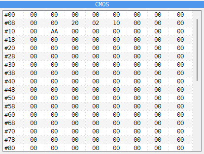

# CMOS panel

```{index} CMOS panel, clock chip
```

```{index} see: RTC; clock chip
```



The **CMOS** panel shows the 256 bytes of the clock chip's memory, eight to a row. The
number at the start of a row is the address of its first byte. It is on a tab beside
**DUMP**, and only on a machine that has a clock chip:

- **ZX Evolution (BaseConf)** and **ZX Evolution (TSConf)**;
- **Pentagon 1024 SL**, and the **Pentagon** with the Gluk clock fitted (see
  [The Gluk clock](options-machine.md#the-gluk-clock));
- **Profi v5**;
- any machine with the **SMUC** hard disk interface, such as the
  **Scorpion ZS 256 Turbo+**.

Double-click a byte and type a new value in hex to change it. Rest the mouse on it for its
value in hex, decimal and binary and the word read from it (see
[Typing a number](debugger-code.md#typing-a-number)).

The time and date in bytes 00 to 09 are not kept here. When the machine reads them, it
gets the time of your computer's clock, so the panel shows only what a program wrote
there. The settings a BIOS keeps in the clock chip are in the bytes from 0E on.

Use it to see which settings a BIOS has stored, or to change one by hand.
