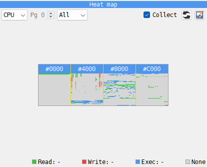

# Heat map panel

```{index} Heat map, Heat map; CSV export, Collect
```



1. What the picture covers - **CPU**, **RAM** or **ROM** - and the page for the last two.
2. The counter shown - **All**, **Read**, **Write** or **Exec**.
3. **Collect**, and the buttons that {icon}`refresh` reset the counters and
   {icon}`save-as` export them.
4. The picture.
5. The address under the mouse, and the legend with its counts.

The **Heat map** counts, for every byte of RAM and ROM, how many times the program has
read it, written it and run it. Click the **Heat map** tab, under the **DUMP**, and tick
**Collect**:
counting starts and goes on while the machine runs, also with the Debugger closed, until
you untick it. With **Collect** off the picture says **collecting is off**.

Each counter has its color: **Read** green, **Write** red, **Exec** blue. A byte nothing
has touched is gray. With **All**, each cell takes the color of the counter that wins:
blue when it was run more often than read and written together, else red when written
more than read, else green. **Exec** counts every byte the CPU reads as part of an
instruction, operands included; **Read** counts only the data it reads.

So the picture reads like a map of the program: blue is code, red is what it changes - the
screen, the variables, the stack - and green is what it only reads, such as graphics,
fonts and tables.

**CPU** shows the 64K the CPU sees now as four squares, one for each 16K window, with one
cell for 4 bytes. **RAM** and **ROM** show one 16K page, with one cell for each byte, and
scroll when the panel is too small.

Hold the mouse over a cell to see its address, the memory and page it is in, and its
counts: **Read:**, **Write:**, **Exec:**. Double-click a cell and the listing goes there,
if the CPU can see that memory now.

The {icon}`refresh` button with the circular arrows resets all counters, after asking.
Loading a snapshot resets them too. The {icon}`save-as` button beside it saves all counters
to a CSV file: one line per byte of RAM and then of ROM, with the columns
`type,page,offset,read,write,exec`, untouched bytes included, for a spreadsheet or a script
of your own.
