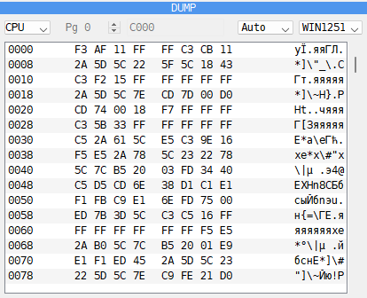
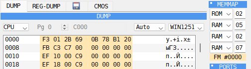
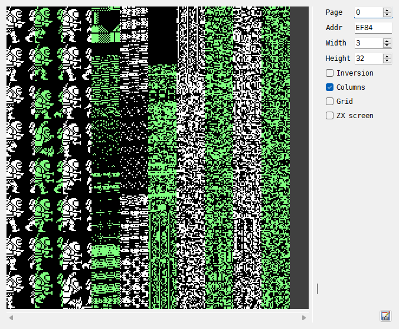
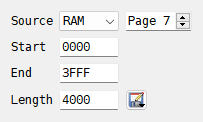
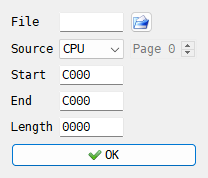

# DUMP panel

The Debugger shows memory byte by byte in the **DUMP** panel, and the bytes the registers
point at in **REG-DUMP**. The tools around them find bytes, fill memory, show it as pictures,
save it to a file and load it back. Which memory pages the CPU sees is in the
[MEMMAP panel](debugger-memmap.md), and which memory the program uses and how in the
[Heat map panel](debugger-heatmap.md).

## The DUMP panel

```{index} DUMP panel, Bytes per row, Code page
```

```{index} see: hex dump; DUMP panel
```



1. **View** - **CPU**, **RAM**, **ROM** or **DIV**, and for the last three the page and its
   address.
2. **Bytes per row** - **Auto**, **8/row**, **12/row** or **16/row**.
3. **Code page** - **WIN1251**, **CP866** or **KOI8R**: how bytes from 128 to 255 show as
   letters in the text column.
4. **Dump** - the address, the bytes in groups of four, and the same bytes as text.
5. **Scrollbar** - drag it to move through memory.

The title of the panel shows the address of the byte under the cursor: **DUMP | 00C000**.

In the text column a byte below 32 shows as a dot. **Auto** puts as many groups of four
bytes on a row as the panel is wide enough for.

### Moving around

```{index} Go to address, DUMP panel; go to address
```

| Key | What it does |
|---|---|
| Up, Down | move the cursor one row; at the edge the dump scrolls by one row |
| PageUp, PageDown | scroll one page up or down |
| mouse wheel | scroll by one row |

These keys can be changed on the **Hotkeys** page of **Options**; the two presets differ only in
**Go to address**, which the Modern preset also gives Ctrl+G (see [Debugger keys](hotkeys.md#debugger-keys)):

| Command | Key | Goes to |
|---|---|---|
| **Go to address** | G (Modern: also Ctrl+G) | the address cell of the top row opens for typing |
| **Go to (PC)** | Ctrl+P | the address in PC |
| **Go to (SP)** | Ctrl+S | the top of the stack |
| **Go to (BC)** | Ctrl+B | the address in BC |
| **Go to (DE)** | Ctrl+D | the address in DE |
| **Go to (HL)** | Ctrl+H | the address in HL |
| **Go to (IX)** | Ctrl+X | the address in IX |
| **Go to (IY)** | Ctrl+Y | the address in IY |

A right-click on a register's name in the **CPU** panel moves the dump to the address the
register holds.

To go to an address, double-click the address of any row, or select it and press Enter, and
type the address to go to. The dump scrolls so that the address lands on that row. An
address can be hex (`8000`, `#8000`, `0x8000`), a label, or a register with a dot in front,
as `.HL`. The labels are offered as you type, as in the listing (see
[Labels offered as you type](debugger-code.md#labels-offered-as-you-type)).

### Editing

```{index} DUMP panel; editing, Allow ROM wr
```

Double-click a byte, or select it and press Enter, and type the new value: two hex digits.
Enter writes it. The text column cannot be edited.

The new value goes into the byte the dump shows. RAM is always written. Memory the machine
itself cannot write is protected: ROM, divMMC's ROM and its page 3 under MAPRAM, and on the
Next its alternate ROM and the Multiface's ROM. Such a byte is written only with
**Allow ROM wr** ticked in the {icon}`settings` **Options** menu of the **Disasm** panel. A
cartridge is never written.

### CPU, RAM, ROM and DIV

```{index} memory page, DUMP panel; RAM and ROM view, DUMP panel; DIV view
```

**CPU** shows the 64K the CPU sees now, with whatever pages are in it. **RAM** and **ROM**
show one whole 16K page, whether the CPU sees it or not. On the ZX Spectrum Next a RAM page
is 8K and **ROM** has its four ROMs, numbered as in the [MEMMAP panel](debugger-memmap.md)
and in labels.

- **Pg** - the number of the page, up to the last one the machine has;
- the address field - the address the first byte of the page is shown at. Switching the
  view sets it to C000 for RAM and 0000 for ROM.

The rows then show the page and the address, as `07:C000`.

**DIV** shows one 8K page of a [divMMC](divmmc.md)'s RAM, whether it is paged in or
not; on a Next, the divMMC RAM it has inside. **Pg** counts the board's pages, the address
starts at 2000, where the board pages them in.

### Selecting and breakpoints

```{index} Fetch break, Read break, Write break
```

Drag over the bytes to select a block, or Ctrl+click its first byte and Shift+click its
last; a click with the middle button clears the selection. The **DUMP** and the **Disasm**
listing share one selection, so a block selected here is ready for **View**, **Fill...** and
the other block commands of the listing (see
[Selecting a block](debugger-code.md#selecting-a-block)). The selection shows in the
**CPU** view only.

A right-click on a byte opens a menu of **Fetch break**, **Read break** and **Write break**:
tick one to stop the machine when the CPU runs, reads or writes that byte. See
[Breakpoints panel](debugger-breakpoints.md).

### The FMAPS window on TSConf

```{index} FMAPS, TSConf; FMAPS
```



On the **ZX Evolution (TSConf)**, while port `15AF` (**FMAddr**) has the FMAPS window on,
the **CPU** view draws its bytes in the **FMAPS** color. The dump shows what is in the bank
there, since a read never reaches the window; a write by the program goes to the bank and
also to the palette, the sprite descriptors or a TSConf register. Hold the mouse over a
byte to see which: `FMAPS: CRAM, color #02`, `FMAPS: SFILE, sprite 3`,
`FMAPS: port #15AF`. The **MEMMAP** row `FM` says where the window is: see
[MEMMAP panel](debugger-memmap.md).

## REG-DUMP

```{index} REG-DUMP panel
```


**REG-DUMP** shares a place with the **DUMP**: click its tab. It has a row for each
register that can point into memory - PC, BC, DE, HL, SP, BC', DE', HL', IX and IY. Each
row starts with the register and its value, `HL (5CB0):`, and goes on with the bytes from
that address, as many as fit. It changes with every step, so you see at once what an
instruction is about to read. It cannot be edited.

## Memory Finder

```{index} Memory Finder, Search, Find pattern
```


**Search** in the {icon}`other` **Tools** menu of the **Disasm** panel opens the
**Memory Finder**, as does the **Find pattern** key: Ctrl+F in both presets.

- **Bytes** - up to 8 bytes in hex, separated by colons: `3E:05:C9`.
- **Mask** - for each byte, the bits that must match: `FF` all of them, `00` none, so that
  any byte will do there, `0F` only the low four bits. Bytes with no mask must match whole.
- **Text** - up to 8 characters. Typing text fills **Bytes** with its codes, and typing
  bytes shows them here as text. The case of the letters matters.

{icon}`search` **Find** goes through the 64K the CPU sees, starting from the address at the
top of the listing. The line under the fields says **Found @** and the address, or
**Not found**. The listing and the **DUMP** go to the place found.

## Memory Filler

```{index} Memory Filler, Fill
```


**Fill...** in the {icon}`other` **Tools** menu opens the **Memory Filler**. With a block
selected, the window opens with the block's start and end filled in.

- **Start address**, **End address** - the memory to fill, ends included.
- **Pattern** - up to 8 bytes, separated by colons. The pattern repeats up to the end
  address.
- **Mask** - used by the **Mask** method only: the bits of each byte that the pattern sets.
- The method, how the pattern is written:

| Method | Each byte becomes |
|---|---|
| **Mask** | the pattern in the bits of the mask, the old byte in the rest |
| **Put** | the pattern |
| **Or** | the old byte OR the pattern |
| **And** | the old byte AND the pattern |
| **Xor** | the old byte XOR the pattern |

{icon}`fill` **Fill** writes the memory the CPU sees and closes the window. ROM is written
only with **Allow ROM wr** ticked.

## Memory Sprite Scanner

```{index} Memory Sprite Scanner, Sprite scanner, sprite; finding
```



**Sprite scanner** in the {icon}`other` **Tools** menu opens the **Memory Sprite Scanner**.
The scanner shows memory as a picture, one bit a pixel, so that sprites, fonts and screens
can be found by eye. The picture here shows Exolon (Raffaele Cecco, Hewson, 1987): with
**Width** 3, the frames of the running hero stand one under another, and **Columns** draws
the memory that follows them in more columns side by side.

- **Page** - the RAM page read for the addresses from C000 to FFFF. At first it is the
  page the CPU has there.
- **Addr** - the first byte shown.
- **Width** - how many bytes make one line of the picture, 8 pixels each.
- **Height** - how many rows of 8 lines the picture has.
- **Inversion** - swaps black and white.
- **Columns** - when **Width** is narrow, the memory that follows is drawn in more columns
  side by side, every second column in green, to fill the picture.
- **Grid** - shades every other 8 x 8 square, to see where the bytes and rows fall.
- **ZX screen** - reads the memory the way the ZX screen lays it out: 6144 bytes from
  **Addr**.

The scrollbar at the right and the mouse wheel move the address by one row of 8 lines.
The {icon}`save-as` button with the floppy and pencil saves the bytes shown - **Width** x
**Height** x 8 of them, or 6144 with **ZX screen** - to a file, as they are in memory.

The scanner window hides when you close the Debugger, and opens again with the Debugger.

## Saving and loading memory

```{index} Save dump, Load dump, Save Memory Dump, Open Memory Dump, Hobeta, memory page; saving
```

**Save dump** and **Load dump** are in the {icon}`floppy` floppy disk menu at the right of
the **Disasm** toolbar. Each has a key of its own: see
[Debugger keys](hotkeys.md#debugger-keys).



**Save Memory Dump** saves a part of memory to a file. **Source** says which memory:

- **CPU** - the 64K the CPU sees now, with whatever pages are in it;
- the memory the machine has, whether the CPU sees it now or not: **RAM**, **ROM**, and
  where the machine has them **Alt ROM**, **divMMC ROM**, **divMMC RAM**,
  **Multiface ROM**, **Multiface RAM** and **Cartridge**. **Page** picks the page; the
  list's tooltip says how big the pages are and how many there are. On a Next, RAM is
  counted in its own 8K pages.

The window opens on what the **DUMP** panel shows: **CPU**, or the RAM, ROM or DIV page
it is on.

Fill in **Start** and **End**, or **Start** and **Length**, in hex: the third field is
filled in by itself. With **CPU** they are addresses. With any other source they count
from the start of the page, and may run on into the pages after it, up to the end of that
memory. Picking another source sets them to one whole page; **Page** 0 with
**Length** 20000 saves all the RAM of a 128K. Then pick from {icon}`save-as` **Save as...**:

- **...as bin** - the bytes as they are, into a file you name;
- **...as Hobeta** - a `.$C` file: a TR-DOS code file. From **CPU** it is named after the
  start address and loads back to it. From a page it is named after the page - `RAM7`,
  `ROM1`, `DIV3`, with the start after a `+` if it is not 0 and the name has room - and
  loads where the CPU sees that page: C000 for RAM, 0000 for ROM, 2000 for divMMC RAM;
- **...to disk A** to **...to disk D** - a code file on the TR-DOS disk in that drive,
  named and placed the same way. A drive with no disk gets a new, formatted one. A file
  saved this way can be up to FF00 bytes long.



**Open Memory Dump** loads a file into memory. The {icon}`fileopen` button beside **File**
picks the file. **Source** and **Page** say which memory it goes into, as when saving.
**Start** is where the file is loaded - C000 at first for **CPU**, the start of the page
for the rest - and **Length** and **End** show how far the file reaches. A file that would
run past the end of the memory is moved down to end there; one too long for it at all is
not loaded. Into **CPU** a file can be up to FF00 bytes long. {icon}`ok-apply` **OK**
writes the file; ROM, divMMC ROM, Alt ROM, Multiface ROM and a cartridge only with
**Allow ROM wr** ticked.

## Example: find where the score is kept

1. Play the game until the score shows a number you can recognize, such as 150.
2. Open the Debugger: **Tools > Debugger**.
3. Open the **Memory Finder** (**Tools > Search**). Many games keep the score as digits:
   type the digits in **Text** as the game shows them, leading zeros included, such as
   `000150`. Click {icon}`search` **Find**.
4. **Found @** gives the address, and the **DUMP** shows the digits there.
5. To check it, change a digit in the **DUMP** - `31` to `39` turns a 1 into a 9 - and
   close the Debugger. The next time the game draws its score, it shows the change.

If the text is not found, the game keeps the score in another form. Try the number as
bytes: `01:50` for 150 kept as decimal digits two to a byte, or `96:00` for 150 as a word,
low byte first. To find the code that adds the points, put a **Write break** on the score
(see [Breakpoints panel](debugger-breakpoints.md)).

## Example: save the screen memory to a file

1. Open the Debugger: **Tools > Debugger**.
2. In the {icon}`floppy` floppy disk menu of the **Disasm** toolbar, choose **Save dump**.
3. Pick **CPU** in **Source**. Type `4000` in **Start** and `1B00` in **Length**. **End**
   shows `5AFF`.
4. Click {icon}`save-as` **Save as...** and choose **...as bin**. Name the file, such as
   `picture.scr`.

The file holds the 6912 bytes of the screen, the picture and then its colors, in the same
layout as a `.scr` screenshot (see [Capture menu](capture.md)).

The second screen of a 128K is in RAM page 7. To save it, pick **RAM** in **Source** and 7
in **Page**, then type `0000` in **Start** and `1B00` in **Length**.
