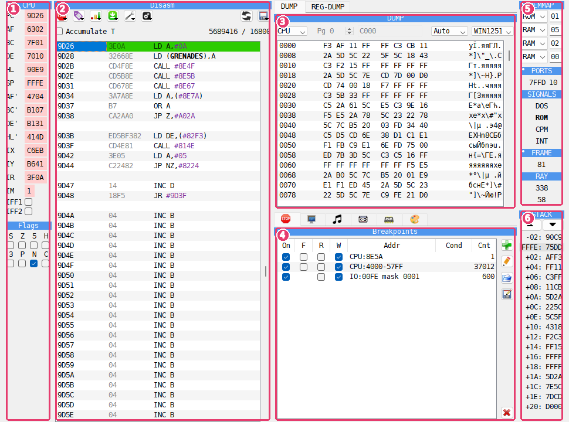

# Debugger

```{index} Debugger
```

The Debugger stops the machine and shows what is inside it: the program as Z80 code, the
CPU registers, the memory, the stack and the state of the devices. From there you run the
program one instruction at a time, change registers and memory, and set breakpoints that
stop the machine where you want it.

This page is about the window, opening and closing it, and running and stepping. Each panel
has a page of its own, listed at the end of [The panels](#the-panels).

## The window

```{index} Debugger; window
```



1. **CPU** - the registers and flags. See [CPU panel](debugger-cpu.md).
2. **Disasm** - the program as code, with the Debugger's buttons and the T-state counter
   above it. See [Disasm panel](debugger-code.md).
3. **DUMP** - memory as bytes, with **REG-DUMP**, **FDD** and **CMOS** on tabs behind it.
4. **Breakpoints** - the list of breakpoints, with **Screen**, **Sound Chip**, **Tape**,
   **FDC**, **Heat map** and **Palette** on tabs behind it. On a ZX Evolution, **ZX Evo**
   is there in place of **Palette**.
5. **MEMMAP** - the memory banks, the watched ports and the state of the machine. See
   [MEMMAP panel](debugger-memmap.md).
6. **STACK** - the words on the stack. See [STACK panel](debugger-stack.md).

Most pictures of the Debugger chapters show it stopped in a game, Exolon (Raffaele Cecco,
Hewson, 1987), with three labels and three breakpoints set for it.

The window title is **Xpeccy+ Debugger**. The Debugger keeps its own position and size,
and its own font, set on the **Debugger** page of **Options**.

## Opening and closing

```{index} Debugger; opening and closing
```

Open the Debugger in any of these ways:

- **Tools > Debugger**, or the {icon}`bug` **Debugger** button on the toolbar;
- **Debugger** in the menu that a right-click on the picture opens;
- the **Debugger** hotkey: F10 (Modern), Esc (Classic);
- `-d` on the command line opens it as soon as the program starts (see
  [Command line](command-line.md#debugging));
- a breakpoint opens it by itself when the machine reaches it (see
  [Breakpoints panel](debugger-breakpoints.md)), unless [DeZog](debugger-dezog.md) is
  connected.

While the Debugger is open, the machine stands still. There is no sound, fast mode is
switched off, and keys pressed in the main window do not reach the machine. The picture in
the main window shows the frame as far as the machine had drawn it; the part not drawn yet
shows the previous frame, darkened. A click on the main window brings the Debugger back to
the front.

To let the machine run on, close the Debugger: press Esc, press the **Debugger** hotkey
again, or close the window. The machine goes on from the instruction the Debugger shows.
That instruction runs first even if a breakpoint is on it, so the machine does not stop on
the same place again at once.

## The panels

```{index} panel
```

Every part of the window is a panel that can be moved. Panels that share a place are
tabs: click a tab to bring its panel to the front. Some tabs show only an icon; the name of
the panel in front is in its title bar.

| Panel | What it shows | Explained in |
|---|---|---|
| **CPU** | the CPU registers and flags | [CPU panel](debugger-cpu.md) |
| **Disasm** | the program as code | [Disasm panel](debugger-code.md) |
| **DUMP** | memory as bytes and text | [DUMP panel](debugger-memory.md) |
| **REG-DUMP** | the memory the registers point at | [DUMP panel](debugger-memory.md) |
| **CMOS** | the clock chip's memory | [CMOS panel](debugger-cmos.md) |
| **Heat map** | how often each memory cell is read, written and run | [Heat map panel](debugger-heatmap.md) |
| **Breakpoints** | the breakpoints | [Breakpoints panel](debugger-breakpoints.md) |
| **Screen** | a ZX screen drawn from memory | [Screen panel](debugger-screen.md) |
| **Sound Chip** | the registers of the sound chips | [Sound Chip panel](debugger-sound-chip.md) |
| **Tape** | the tape's state and the signals in and out | [Tape panel](debugger-tape.md) |
| **FDC** | the floppy disk controller and the drive | [FDC panel](debugger-fdc.md) |
| **FDD** | the bytes on a track of a floppy disk | [FDD panel](debugger-fdd.md) |
| **Palette** | the colors of the machine's palette | [Palette panel](debugger-palette.md) |
| **ZX Evo** | the video and memory hardware of a ZX Evolution | [ZX Evo panel](debugger-zx-evo.md) |
| **ZX Next** | the registers, sprites, copper, layers and DMA of a ZX Spectrum Next | [ZX Next panel](debugger-zx-next.md) |
| **MEMMAP** | the memory banks, ports and signals | [MEMMAP panel](debugger-memmap.md) |
| **STACK** | the words on the stack | [STACK panel](debugger-stack.md) |

**CMOS** is there only on machines that have a clock chip: the ZX Evolution with BaseConf
or TSConf, the Pentagon 1024, the Profi v5, and any machine with a SMUC. **FDC** and **FDD**
are there only on a machine with a disk interface. **ZX Evo** is there only on a ZX
Evolution, with TSConf or BaseConf, and **Palette** on every other machine. **ZX Next** is
there only on a ZX Spectrum Next.

**Screen**, **Sound Chip** and **Heat map** can also be windows of their own: **Tools >
Screen**, **Tools > Sound Chips** and **Tools > Heat Map** open them, and they work while
the machine runs. **ZX Evo** and
**ZX Next** can be too, from the {icon}`display` button at the top right of the panel. See
[Device panels](#device-panels).

### Arranging the panels

```{index} panel; arranging, Reset panel layout
```

Drag a panel by its title bar and drop it where you want it: beside another panel, above
or below it, or onto it to put the two panels on tabs. Drop it at the far left or far right
edge of the window to give it a column of its own. Drag the line between two panels to
share the room differently.

A panel cannot be closed, and it cannot leave the window.

The arrangement is kept: the next time the Debugger opens, and the next time the program
starts. To get the arrangement it ships with, choose **Reset panel layout** from the
{icon}`settings` **Options** button over the listing. This command also brings the window
back to its original size.

### Device panels

```{index} Debugger; device panels
```

Besides the CPU and the memory, the Debugger shows the state of the machine's devices: the
screen, the sound chips, the tape, the floppy disk controller, the clock chip and the
palette, and on a ZX Evolution or a ZX Spectrum Next its video hardware. Each is a panel of its own, on a tab
beside **Breakpoints** or **DUMP**. Like every panel, they show the state the machine stopped in and change with each step.

The **Screen** and **Sound Chip** panels can also be windows of their own that work while
the machine runs: see [Screen and Sound Chips windows](tools.md#screen-and-sound-chips-windows).
So can the **ZX Evo** and **ZX Next** panels: see
[The ZX Evolution window](debugger-zx-evo.md#the-zx-evolution-window).

| Panel | Shown on | Use it to |
|---|---|---|
| **Screen** | every machine | see a screen in memory and find the address of a dot |
| **Sound Chip** | every machine | read and change the registers of the AY and YM chips |
| **Tape** | every machine | see the tape signal around the current position |
| **FDC** | a machine with a disk interface | see the registers of the disk controller and the drive |
| **FDD** | a machine with a disk interface | read the raw bytes of a disk track |
| **CMOS** | a machine with a clock chip | read and change the memory of the clock chip |
| **Palette** | every machine but the ZX Evolution | see the colors of the machine's palette |
| **ZX Evo** | a ZX Evolution, with TSConf or BaseConf | see what its video and memory hardware is set to, and hide TSConf layers |
| **ZX Next** | a ZX Spectrum Next | see its registers, sprites, copper, layers, tilemap, palettes and DMA |

**ZX Evo** and **ZX Next** are made for one machine each. On a ZX Evolution, **ZX Evo**
takes the place of **Palette** and has a **Palette** tab of its own; on the Next,
**Palette** stays beside **ZX Next**.

### The pages of the panels

The rest of this part of the manual has a page for each panel, and one for the
**Watcher** window:

```{toctree}
:maxdepth: 2

debugger-cpu
debugger-code
debugger-memory
debugger-memmap
debugger-stack
debugger-heatmap
debugger-breakpoints
debugger-watcher
debugger-screen
debugger-sound-chip
debugger-tape
debugger-fdc
debugger-fdd
debugger-cmos
debugger-palette
debugger-zx-evo
debugger-zx-next
debugger-dezog
```

## The buttons over the listing

A row of buttons above the **Disasm** panel holds the Debugger's menus. Hold the mouse over
a button to see its name. The menus that belong to the listing are described in full in
[The toolbar](debugger-code.md#the-toolbar).


| Button | What is in it |
|---|---|
| {icon}`stop` **Breakpoints** | **Fetch break**, **Read break**, **Write break** on the line or block - see [Breakpoints panel](debugger-breakpoints.md) |
| {icon}`label` **Labels** | show, load, save and list labels - see [Disasm panel](debugger-code.md) |
| {icon}`bars` **View** | show the lines as **Opcode**, **Byte**, **ASCII**, **Word** or **Address** - see [Disasm panel](debugger-code.md) |
| {icon}`arrGreen` **Trace** | the kinds of trace - see [Trace](#trace) |
| {icon}`other` **Tools** | **Search**, **Fill...**, **Sprite scanner** ([DUMP panel](debugger-memory.md)), **Keyboard** (the [Virtual Keyboard](view.md#virtual-keyboard)), **Watcher** ([Breakpoints panel](debugger-breakpoints.md)) |
| {icon}`settings` **Options** | how the listing looks, writing to ROM, runtime mapping ([Disasm panel](debugger-code.md)), and **Reset panel layout** |
| {icon}`refresh` **Reload snapshot & labels** | opens the last file again and its labels, as **File > Reload** does |
| {icon}`floppy` (disk) | **Disasm to file**, **Load dump**, **Save dump**, **Load session**, **Save session** - see [Disasm panel](debugger-code.md) and [DUMP panel](debugger-memory.md) |

## Running and stepping

```{index} step, step; keys, Fast step
```

These keys work while the Debugger has the focus. The **Hotkeys** page of **Options** lists
them under **Debugger**, and changes them there (see [Hotkeys page](hotkeys.md)).

| Action | Modern | Classic | What it does |
|---|---|---|---|
| Step in | F7 | F7 | runs one instruction |
| Step over | F8 | F8 | runs one instruction; a call or a loop runs to its end |
| Step out | Shift+F8 | F6 | runs until the current subroutine returns |
| Fast step | Alt+F7 | Alt+F7 | runs ten instructions |
| Stop here | F4 | F9 | runs until the line under the cursor |
| Trace | Ctrl+T | Ctrl+T | runs instruction by instruction until you press a key |
| Close | Esc | Esc | closes the Debugger and lets the machine run |

After each step every panel shows the new state, and the registers that changed are
marked.

```{index} Step in, Step over, Step out, Stop here
```

**Step in** runs the instruction at PC, the line marked in the listing. Hold the key down
to keep stepping: the Debugger traces, as with **Trace**, until you release the key.

**Step over** runs some instructions to their end in one step: CALL, RST, DJNZ, HALT and
the repeating block instructions LDIR, LDDR, CPIR, CPDR, INIR, INDR, OTIR and OTDR. The
Debugger closes, the machine runs at full speed until it reaches the instruction that
follows in memory, and the Debugger opens again there. Any other instruction is one step,
as with **Step in**.

**Step out** lets the machine run until the subroutine it is in returns. Calls and
interrupts made on the way are counted, so only the RET that ends this subroutine stops
the machine. The Debugger opens after that RET.

**Stop here** runs the machine at full speed until PC reaches the line the cursor is on
in the listing. Click the line first, so the listing has the focus.

**Step over**, **Step out** and **Stop here** let the machine run with the Debugger
closed. If a breakpoint stops the machine first, or you open the Debugger yourself, the
place where the machine was to stop is forgotten. If the program never gets there, the
machine just runs on.

While you step or trace, breakpoints are not checked. They work again once the machine
runs with the Debugger closed, from the instruction at PC: a read, a write or a port it
uses can stop the machine at once, and the Debugger then stays open after that instruction.
So **Step out** with PC on the RET itself stops after that RET.

### Trace

```{index} trace, Trace and stop here, Trace and stop on INT, Trace log
```

Trace runs the program one instruction after another, and the panels show each step as it
happens. Press any key to stop it. Trace is much slower than the machine at full speed.

The {icon}`arrGreen` **Trace** button over the listing holds four kinds of trace:

- **Trace** - until you press a key;
- **Trace and stop here** - until PC reaches the line the cursor is on. It is also in the
  menu that a right-click on the listing opens;
- **Trace and stop on INT** - until an interrupt comes that the CPU will take;
- **Trace log** - asks for a file name, then traces until you press a key and writes one
  line per instruction into the file.


```{index} trace; log format
```

The first line of a trace log names the columns. On a Z80 it reads:

```
addr|command|PC|AF|BC|DE|HL|SP|AF'|BC'|DE'|HL'|IX|IY|IR|IM|IFF1|IFF2
```

Each following line is one instruction: its address, the instruction itself, and the
registers after it ran, in hex. The columns are separated by `|`, and the numbers are in
quotes so that a spreadsheet keeps them as text: open the file there with `|` as the
separator.

### The T-state counter

```{index} T-state counter, Accumulate T, T-state; counting
```

Above the listing, on the right, are two numbers:

- the left one is the number of T-states the last step took. After the machine ran with
  the Debugger closed - **Step over**, **Stop here**, a breakpoint - it is the T-states of
  that whole run;
- the right one is the number of T-states since the start of the current frame, that is,
  since the last frame interrupt.

Tick **Accumulate T** to add the steps up: the left number keeps growing from step to step
until you untick it. Ticking it starts the count again from 0.

The count is the real time on the machine, with memory contention and the interrupts that
came in between.

## Examples

### Stop at the start of a loaded program and step through it

```{index} breakpoint; at the start of a program
```

A program on tape usually loads a code block and starts it at its first byte. The
**Info** column of the **Tape Player** shows where a code block loads, for example
`CODE 32768,6912`: the program starts at 32768, which is `8000` in hex.

1. Mount the tape - do not run it (see [Run a program](getting-started.md#run-a-program)).
2. Open the Debugger. Click the listing, press G, type `8000` and press Enter. The listing
   shows address 8000 (see [Typing an address](debugger-code.md#typing-an-address)).
3. Press Space. The line gets a breakpoint, shown in the **Break** color.
4. Press Esc. The machine runs.
5. Load the tape: `LOAD ""` in 48K BASIC, or **Tape Loader** in the 128K menu.
6. When the loader jumps to the program, the Debugger opens with the first instruction at
   8000 marked as PC. Nothing of the program has run yet.
7. Press F7 to run one instruction at a time and watch the registers change. Press F8 on a
   CALL to run the whole subroutine at once.

The breakpoint stays and stops the machine there again the next time. Press Space on the
line again to remove it.


### Count the T-states of a routine

```{index} T-state; timing a routine
```

1. Stop the machine on a CALL of the routine, with a breakpoint or by stepping to it.
2. Make sure **Accumulate T** is not ticked.
3. Press F8 (**Step over**). The routine runs at full speed, and the Debugger opens again
   on the line after the CALL.
4. The left number of the T-state counter is the time the CALL took, the routine and its
   RET included.

To time a part of a routine instead, step to where the part begins, click the line where it
ends and press **Stop here**: F4 (Modern), F9 (Classic).

To add up a few instructions, tick **Accumulate T** - the left number starts from 0 - and
press F7 for each one. The left number is their sum.


