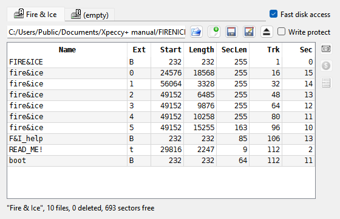

# Floppy disks

```{index} Floppy Drives
```

The floppy drives are in the **Media** menu: **Floppy Drives** has the commands of each
drive, **Disk Manager** shows the files on the disks, **Fast Disk Access** skips the
waits of a real drive. Which machine has which drives is in
[Which machine has what](media.md#which-machine-has-what); the drives themselves are set up
in [Machine: Disk](options-machine.md#machine-disk).

## Putting a disk in

```{index} floppy disk, Floppy Drives, Write Protect
```

```{index} see: floppy; floppy disk
```

Open a disk image with **File > Open...**, or drop it onto the window: it goes into drive A
(see [Run a program](getting-started.md#run-a-program)). To put it into another drive, pick
**Disk B**, **Disk C** or **Disk D** as the file type in the open dialog.


**Media > Floppy Drives** has a submenu for each drive the machine has. The submenu is named
after the disk in the drive, or **(empty)**; the drive letter is on its icon. A star after
the name means the disk has been changed and not saved yet. Each submenu has:

- **Open...** - put a disk image into this drive. It is only mounted: nothing starts, and
  the machine stays the same.
- **New** - put an empty disk into this drive. On a Beta Disk machine you are asked
  **Format for TR-DOS?**: {icon}`ok-apply` **Yes** gives an empty TR-DOS disk ready for
  files, {icon}`cancel` **No** gives an unformatted one, for a program that formats it
  itself.
- **Save** - write the disk back to the file it came from.
- **Save As...** - write the disk to a new file; you pick the name and the format.
- **Eject** - take the disk out.
- **Write Protect** - the machine cannot write to this disk, as with the tab on a real one.

A right-click on a drive's {icon}`diskGreen` light in the status bar opens the same menu.

## Disk formats

```{index} TRD, SCL, UDI, DSK, TD0, FDI, IMA, Hobeta, RAW file to disk
```

| Format | Opens | Saves | What it is |
|---|---|---|---|
| `.trd` | yes | yes | TR-DOS disk, sector by sector |
| `.scl` | yes | yes | TR-DOS files packed together without the empty space |
| `.udi` | yes | yes | the whole disk track by track, as the drive reads it |
| `.dsk` | yes | yes | +3 disk (extended DSK too) |
| `.td0` | yes | - | Teledisk image |
| `.fdi` | yes | - | FDI image |
| `.ima`, `.img` | yes | - | 1.44 MB PC floppy |
| `.$B`, `.$C`... | yes | - | Hobeta: one TR-DOS file |

A **Hobeta** file is not a disk but a single TR-DOS file. Opening it into a drive adds the
file to the disk that is there; an empty drive gets a new TR-DOS disk with the file on it.

Any other file can be opened as **RAW file to disk**: it is copied onto the TR-DOS disk in
the drive as one file, named after the host file. A file longer than 65280 bytes is split
into several parts.

## The boot file

```{index} boot file, Add boot loader
```

Most TR-DOS disks start with a file named `boot`, which the machine runs when it boots from
the disk. When a TR-DOS disk has no `boot` of its own, Xpeccy+ adds one as the disk is opened,
so the disk starts by itself and shows a menu of its files. Adding this file does not count
as a change to the disk, and the image file is not touched unless you save the disk.

To stop this, open the **Machine** page of **Options**, click the {icon}`settings` gear in
the **Disk** row and clear **Add boot loader**. The file added is `boot.$B` in the
[settings folder](getting-started.md#where-the-settings-are); put another Hobeta file there
under the same name to use your own.

## Fast Disk Access

```{index} Fast Disk Access
```

Real drives spend time moving the head and waiting for the sector to come around.
**Media > Fast Disk Access** skips those waits, so disks load much faster. The same switch
is in the **Disk Manager** and in **Machine: Disk**.

## Changed disks

```{index} disk; saving, Save Changed Disks, Remember mounted media
```

What the machine writes to a disk stays in memory: the image file changes only when you
save the disk.

**File > Save Changed Disks** asks about each drive whose disk was changed:
**Disk A: game.trd has been changed. Do you want to save it?** **Yes** writes the disk to its
file, **No** goes on without saving it, **Cancel** stops asking. For a new disk that has no
file yet you are asked for a file name. The same happens for a disk opened from a format
Xpeccy+ reads but does not write, such as `.td0`, `.fdi` or `.ima`. When a save fails, a
message says why, and the disk stays changed.

Before a changed disk is ejected or replaced, and when you close Xpeccy+, you are asked the
same question. **Cancel** keeps the disk in the drive, or keeps the program open.

With **Remember mounted media** on the **File types** page of **Options**, the disks in the
drives are opened again at the next start.

## Disk Manager

```{index} Disk Manager, Copy to tape, Save as Hobeta, Save as RAW
```



**Media > Disk Manager** (also {icon}`fdd_disk` on the toolbar, and a click on a drive
{icon}`diskGreen` light in the status bar) shows what is in the drives and on the disks. In
the picture drive A holds Fire 'n Ice (n-Discovery, 2003).

- **Tabs** - one for each drive, named after the disk's own TR-DOS label or the file name.
  **Fast disk access** beside them is the same switch as in the **Media** menu.
- **The line under the tabs** - the file in the drive, then buttons to {icon}`fileopen` open
  a disk image, {icon}`doc-new` insert a new disk, {icon}`floppy` save the changes to the
  disk's own file, {icon}`save-as` save the disk to a new file, and {icon}`tape-eject` eject,
  and the **Write protect** box.
  They do what the **Floppy Drives** menu does.
- **The catalog** - the files on a TR-DOS disk: **Name**, **Ext**, **Start**, **Length**,
  **SecLen** (length in sectors), **Trk** and **Sec** (where the file begins). A +3DOS disk
  has columns of its own (see below); any other disk shows no catalog.
- **The line at the bottom** - the disk's label, how many files and deleted files it has,
  free sectors, and **modified** when it has unsaved changes. While the drive's motor runs,
  **Head on track** shows where the head is, and the file under it is shown in bold.

Select one or more files in the catalog (Ctrl or Shift for several) and use the buttons on
the right:

- {icon}`tape` **Copy to tape** - add the files to the tape in the [Tape Player](tapes.md),
  as BASIC programs or code blocks. A file whose length does not match the number of sectors
  it occupies (several files joined into one) is skipped.
- {icon}`dollar` **Save as Hobeta** - write each file to a folder you pick as a Hobeta file
  (`name.$C`).
- {icon}`filebin` **Save as RAW** - write each file's bare data, with no header (`name.C`).

The window is kept up to date as the machine runs: a file the program writes shows up in
the catalog straight away.

### +3DOS disks

```{index} +3DOS; Disk Manager, CPC disk
```

A +3 disk shows its files too, and so do the CPC system and data disks, which the +3 also
reads. The columns are **Name**, **Ext**, **Type** (**Program**, **Numbers**, **Chars** or
**Bytes**), **Start** (a program's autostart line, or the address of code), **Length**,
**Size** (the space the file takes on the disk), **Trk** and **Sec**. A file in a user area
other than 0 has its number before the name, as `3:GAME`. The line at the bottom says which
kind of disk it is, how many files it has and how much space is free.

The buttons work as on TR-DOS. {icon}`tape` **Copy to tape** and {icon}`dollar`
**Save as Hobeta** need the file's +3DOS header, which gives its type, address and length; a
file without one is skipped. {icon}`filebin` **Save as RAW** writes the data without the
header, or the whole file when it has none.
