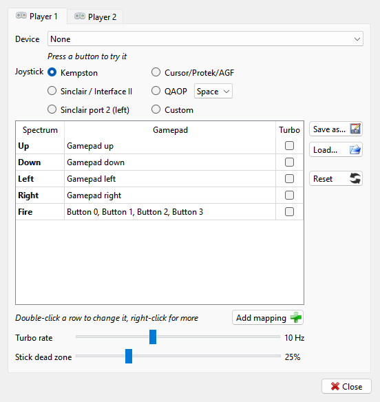

# Keyboard, joystick and mouse

Type on the PC keyboard and the machine gets the keys. A gamepad, or a few keys of the PC
keyboard, can be a joystick; the PC mouse can be a Kempston mouse. The **Input** menu has the
commands for all of this: **Grab Keyboard**, **Grab Mouse**, **Keymap** and **Gamepads**.

## The keyboard

```{index} keyboard, Caps Shift, Symbol Shift, BREAK
```

The Spectrum keys are where they are on the PC: letters, digits, Space and Enter. The two
shift keys of the Spectrum are on the left of the PC keyboard:

| PC key | Spectrum key |
|---|---|
| Left Shift | Caps Shift |
| Left Ctrl | Symbol Shift |

Other PC keys press two Spectrum keys together:

| PC key | Spectrum keys | Gives |
|---|---|---|
| Backspace | Caps Shift + 0 | DELETE |
| arrows | Caps Shift + 5, 6, 7, 8 | cursor left, down, up, right |
| Esc, Tab | Caps Shift + Space | BREAK |
| Caps Lock | Caps Shift + 2 | CAPS LOCK |
| Page Up | Caps Shift + 3 | TRUE VIDEO |
| Page Down | Caps Shift + 4 | INV. VIDEO |
| Delete | Caps Shift + 9 | GRAPHICS |
| `` ` `` and `\` | Caps Shift + Symbol Shift | extended mode |
| Home | Symbol Shift + Q | <= |
| End | Symbol Shift + E | >= |
| `[` and `]` | Symbol Shift + 8, 9 | ( and ) |
| `;` | Symbol Shift + O | ; |
| `'` | Symbol Shift + P | " |
| `-` | Symbol Shift + J | - |
| `=` | Symbol Shift + K | + |
| `,` and `.` | Symbol Shift + N, M | , and . |
| `/` | Symbol Shift + C | ? |

The F-keys, Alt, Insert, the right Shift and Ctrl and the numeric keypad do nothing on the
machine.

A key that is a hotkey runs its command instead of reaching the machine. Which keys those are
depends on the set of hotkeys you use: in Modern, Delete, Home, End and Insert are hotkeys,
while Esc is left to the machine as BREAK. See [Hotkeys](hotkeys.md). To give the machine
every key, grab the keyboard.

```{index} keyboard; system layout
```

On Windows and Linux a key is recognized by its place on the keyboard, not by the letter the
system layout puts on it, so a Cyrillic or another layout switched on in the system changes
nothing.

## Keymaps

```{index} keymap
```

A keymap says which PC key presses which Spectrum key. Pick one in **Input > Keymap**, or in
the **Keymap** list on the **Input** page of **Options**:

- **Default** - the keys described above;
- **ZX Spectrum 48K.map** - Caps Shift on both left Shift and left Ctrl, Symbol Shift on both
  right Shift and right Ctrl, as the two keys are placed on a 48K. The `` ` `` key is EDIT
  (Caps Shift + 1) and `\` is GRAPHICS (Caps Shift + 9);
- **ZX Spectrum 128K.map** - Caps Shift on both Shift keys, Symbol Shift on both Ctrl keys.
  The `` ` `` key is EDIT.

A keymap changes only the keys it names; all the others stay as in Default.

On macOS the program cannot tell the left Shift from the right one, nor the left Ctrl from
the right one. The 48K keymap then has no Symbol Shift: use Default or the 128K one there.

### Your own keymap

```{index} keymap; own, MAP
```

A keymap is a text file with the extension `.map`, put in the `keymaps` folder of the settings
folder (see [Where the settings are](getting-started.md#where-the-settings-are)). It shows in
the **Keymap** menu the next time the menu is opened. A file with the name of a built-in
keymap is used instead of that one.

Each line is one PC key, then the Spectrum keys it presses, all separated by tabs:

```
`	C	1
LS	C
RS	S
```

The first line makes the `` ` `` key press Caps Shift and 1 together, which is EDIT. A line with a
PC key alone makes that key press nothing.

PC keys are named `1` to `0`, `A` to `Z`, `ENT`, `SPC`, `LS` and `RS` (left and right Shift),
`LC` and `RC` (Ctrl), `LA` and `RA` (Alt), `TAB`, `CAPS`, `BSP`, `ESC`, `F1` to `F11`, `UP`,
`DOWN`, `LEFT`, `RIGHT`, `HOME`, `END`, `INS`, `DEL`, `PGUP`, `PGDN`, the symbol keys
`` ` ``, `\`, `[`, `]`, `;`, `"` (the quote key), `-`, `+` (the = key), `,`, `.`, `/`, and on
the numeric keypad `N0` to `N9`, `NDOT`, `NENT`, `NPLUS`, `NMINUS`, `NMUL`, `NSLASH`,
`NLOCK`.

Spectrum keys are one character each: `1` to `0`, the letters in lower case `a` to `z`, `E`
for Enter, `C` for Caps Shift, `S` for Symbol Shift, and a space for Space.

A PC key can also move the Kempston joystick: `JU`, `JD`, `JL`, `JR` for up, down, left and
right, `JF` for fire, `J2` to `J4` for the extra buttons.

## Grab Keyboard

```{index} Grab Keyboard, keyboard; grabbing
```

**Input > Grab Keyboard** gives the whole PC keyboard to the machine. While it is on:

- every key reaches the machine, Esc and the F-keys included;
- the hotkeys stop working, except the key of **Grab Keyboard** itself (ScrollLock or Alt+G
  in Modern, Alt+G in Classic);
- a player set up in **Gamepads** to use the keyboard no longer gets its keys: they reach
  the machine as ordinary keys;
- the commands in the menus and on the toolbar still work.

To release the keyboard, press the **Grab Keyboard** key again, or press Ctrl and Alt together
and release them with no other key between (Ctrl and Cmd on a Mac). A short message on the
picture says when the keyboard is grabbed and released.

## Machines with a keyboard of their own

```{index} Profi; keyboard, PC keyboard, scan code set
```

**Profi.** A Profi has a PC-style keyboard of its own. With the keyboard grabbed, the PC
keyboard works as that keyboard: the keys type the characters printed on them, Shift
included, and F1 to F10, Home, End, Page Up, Page Down, Insert and Delete give the Profi's
own keys. When the keyboard is not grabbed, the PC keyboard works as the Spectrum keyboard
described above.

**ATM Turbo 2+ and ZX Evolution.** These machines read a PC keyboard as well as the
Spectrum one, and every key you press reaches both. The **PC keyboard** row in the **Input**
group of the **Machine** page of **Options** sets the scan codes the machine gets:
**As the machine has it**, **Scanset 1 (XT)**, **Scanset 2 (AT)** or
**Scanset 3 (PS/2)**. Leave it as the machine has it unless a program asks for another set.

## Virtual Keyboard

```{index} Virtual Keyboard, Dock under the emulator
```


**View > Virtual Keyboard > Show** (Alt+K) opens a picture of the Spectrum keyboard. The keys that are
pressed on the machine light up, whether they come from the PC keyboard, a joystick on keys
or a click here.

- Left button on a key - holds the key down while the button is held. On Caps Shift and
  Symbol Shift it locks the key down instead, and a second click releases it: click Caps
  Shift, then a digit, to get a cursor key.
- Right button on a key - locks the key down; a second right click releases it.
- Middle button on a key - releases all the keys.

A key takes clicks on itself and on the words over and under it. Right-click between the
rows or beside the keys for its settings; they are also under **Show** in **View > Virtual
Keyboard** and in the **Virtual Keyboard** submenu of the picture's right-click menu, which
is easier with the 128K's close-set keys:

- **Zoom x1**, **Zoom x1.5**, **Zoom x2**, **Zoom x3** - the size of the window. You can
  also drag its edge; the picture keeps its shape and is drawn sharp at any size.
- **Skin** - **48K (Classic)**, **48K (White)**, **128K (Classic)**, **128K (White)**,
  **Next (Black)**, **Next (White)** or **Next (Magenta)**; one picked here stays whatever
  the machine. **By machine**, on by default, shows the Next keyboard on the ZX Spectrum
  Next, the 128K one on a 128K, +2, +2A or +3 and the 48K one on every other machine, in
  the tone picked last; only the Next has a Magenta one, the others show their classic one.
- **Dock under the emulator** - the keyboard loses its frame and sits under the main window,
  as wide as the main window, and moves with it. In fullscreen, or when there is no room
  below, it lies over the bottom of the picture.
- **Highlight the key under the pointer** - the key the mouse is over lights up as a
  pressed one does, but dimly, so you can see which key a click will take. On by default.
- **Release all keys** - releases every key.

Keys typed while the window is in front go to the machine. Esc closes the window. Not
docked, it opens again where it was left.


On the 128 keyboard the extra keys (True Video, Edit, Delete, the cursor keys and the
rest) press Caps Shift or Symbol Shift together with a key, as on the real one; a right
click locks such a key whole.

For layout authors: a file `zx-black.json`, `zx-white.json`, `zx-128.json`,
`zx-128-white.json`, `zx-next.json`, `zx-next-white.json` or `zx-next-magenta.json` in the `vkbd` folder of the settings folder (see
[Where the settings are](getting-started.md#where-the-settings-are)) is drawn instead of the
built-in skin of that name, and drawn again each time the file is saved.

## Joysticks

```{index} joystick, joystick; Kempston, Kempston joystick, ALF TV Game; joysticks
```

The joystick interface of the machine is set on the **Machine** page of **Options**, in the
**Input** group: **Joystick** is **None**, **Kempston 5-bit** or **Kempston 8-bit**. The 8-bit
one has three more fire buttons, **Fire 2** to **Fire 4**.

Sinclair, cursor and QAOP joysticks are keys on the Spectrum keyboard, so they need no
interface: a player set up in the **Gamepads** window presses those keys for you.

The ALF TV Game consoles have no keyboard: there the arrows with Space or Enter are the first
joystick, and W, A, S, D with left Shift or left Ctrl are the second.

## Gamepads

```{index} Gamepads, gamepad, joystick; Sinclair, joystick; Cursor, joystick; QAOP, joystick; Custom
```

```{index} see: joypad; gamepad
```



**Input > Gamepads > Manage...** opens the **Gamepads** window. It has a tab for each of two
players, **Player 1** and **Player 2**. A change takes effect at once; there is nothing to
apply.

**Device** - what the player plays with:

- **None**;
- **Keyboard: arrows + Ctrl** - the arrows, and either Ctrl for fire;
- **Keyboard: WASD + Space**;
- a gamepad connected to the PC, or one used before and now unplugged, marked
  **(not connected)**.

Under it, a line shows what the last button or key pressed does, so you can try the pad right
there. A gamepad plugged in for the first time is given to a player that has no device, and
the window opens by itself to show it (not in fullscreen).

On macOS a gamepad with an XInput / DInput switch is not seen at all in XInput mode: switch it
to DInput.

**Joystick** - which joystick the Spectrum sees for this player:

| Joystick | Up, down, left, right, fire |
|---|---|
| **Kempston** | the Kempston interface |
| **Sinclair / Interface II** | keys 9, 8, 6, 7, 0 |
| **Sinclair port 2 (left)** | keys 4, 3, 1, 2, 5 |
| **Cursor/Protek/AGF** | keys 7, 6, 5, 8, 0 |
| **QAOP** | keys Q, A, O, P, and Space or M for fire, picked in the list beside it |
| **Custom** | Spectrum keys of your own; it starts as QAOP and Space |

Picking **Kempston** switches the machine's Kempston joystick on if it is off. The rows
**Fire 2** to **Fire 4** are shown only when the machine has the 8-bit Kempston.

```{index} autofire, Turbo rate, Stick dead zone
```

The table lists what the player can do. The first rows, in bold, are the joystick: **Up**,
**Down**, **Left**, **Right**, **Fire**. The second column shows the buttons or keys for
each row. On a gamepad the directions are the D-pad and the left stick, shown as
**Gamepad up** and so on, and **Fire** is every face button no other row uses.

- Double-click a row, or right-click it and choose **Change...**, to set its buttons.
- {icon}`add` **Add mapping**, or **Add...** on the right-click menu, adds a row of your
  own.
- Right-click a row of your own and choose **Delete** to remove it; on a joystick row the
  menu has **Back to defaults** instead.
- Tick **Turbo** on a row to make it repeat while the button is held. **Turbo rate** sets how
  fast, from 1 to 25 times a second.
- **Stick dead zone** - how far a stick has to move before the move counts. A player on the
  keyboard has no stick, and the setting is grayed out.

### Setting up a row

```{index} gamepad; binding
```

The window that **Change...** opens has two sides. The right side, **Gamepad** or **PC
Keyboard**, lists the buttons or keys that work the row: press the buttons on the pad, or
click in the box and press the keys. The first one replaces what the row had, the next ones
are added. {icon}`add` **Add from list** picks a pad input by name, with no pad needed.
**Clear** empties the list, **Defaults** puts back the joystick row's own buttons.

The left side, **Spectrum**, says what the row does on the Spectrum. On a joystick row that
is set by the **Joystick** choice, except on **Custom**, where you pick the key. A row you
added can do one of these:

- **Joystick** - press up, down, left, right or fire of the player's joystick, whichever
  joystick it is;
- **Key** - press a Spectrum key: pick it from the list, or click **Press** and press the PC
  key it is on. **Modifier** holds Caps Shift or Symbol Shift with it;
- **Kempston** - press a Kempston direction or fire button;
- **Mouse** - move the Kempston mouse, press its button or turn its wheel. A move gets faster
  the longer it lasts;
- **Action** - run any command of the emulator, as its hotkey does.

**Turbo: repeats while held** is the row's **Turbo** box. {icon}`ok-apply` **OK** keeps the
changes.

### Saving the bindings

```{index} PAD, gamepad; saving bindings, gamepad; presets
```

{icon}`floppy` **Save as...** writes the player's table to a `.pad` file; {icon}`fileopen`
**Load...** reads one back. Its menu lists the last eight files loaded or saved, by name,
with a check by the one the table matches, and **Browse...** below them for any other file;
when there are no such files yet, **Load...** opens the file dialog at once.
{icon}`refresh` **Reset** sets the player back to the joystick's defaults and deletes the
rows you added.

```{index} Game bindings
```

**Game bindings.** When the box **Game bindings** on the **Input** page of **Options** is
ticked, opening a tape, disk or snapshot looks for a `.pad` file of the same name beside it:
for `Exolon.tzx` that is `Exolon.pad`. Player 1 uses those bindings until the next file is
opened, and the window says **From Exolon.pad, until the next image** beside a
{icon}`cancel` **Revert** button, which goes back to your own bindings. **Save as...**
offers that name and place, so saving a table for a game is one click.

When you change player 1's bindings while a game's file is in use, the program asks where the
change goes: **Game config** saves it into the game's `.pad` file, **User config** makes the
table your own, **Temporary** keeps it until the next file. {icon}`cancel` **Cancel**, Esc or
closing the question undoes the change.

### Quick switch

```{index} joystick; quick switch
```

**Input > Gamepads** also lists the joysticks for player 1, with the device in use above
them, so you can switch from Kempston to Sinclair mid-game without opening the window. Below
them, **Saved presets** lists the same files as **Load...**, and **Reset to defaults** goes
back to the joystick's defaults. The **Input** page of **Options** shows what each player
has, with a **Gamepads...** button that opens the window.

## Mouse

```{index} Kempston mouse, mouse; sensitivity, Grab Mouse, mouse; grabbing
```

To use the PC mouse as a Kempston mouse, set **Mouse** to **Kempston mouse** in the **Input**
group of the **Machine** page of **Options**. The {icon}`settings` button beside it opens
its settings:

- **Sensitivity** - how fast the pointer moves. In the middle position the Spectrum pointer
  moves as fast as the PC pointer.
- **Wheel** - the wheel is read too, as on the extended Kempston mouse.
- **Swap buttons** - the left and right buttons trade places.

The machine gets the mouse only while the mouse is grabbed. Grab it in one of these ways:

- click the picture with the middle button;
- click the picture with the left button, while a program reads the mouse;
- **Input > Grab Mouse**.

While the mouse is grabbed, the PC pointer is hidden and the buttons go to the machine, the
wheel too when **Wheel** is ticked. The same hand movement moves the Spectrum pointer the
same distance, whatever size the picture is drawn at. To release the mouse, click the
middle button again, use **Grab Mouse** again, or press Ctrl and Alt together and release
them (Ctrl and Cmd on a Mac).

## Input Overlay

```{index} Input Overlay
```

**View > Input Overlay** draws the keys, the joystick and the mouse over the picture, lit
while they are pressed. It is marked **EXPERIMENTAL** in the menu.

- **Show** - the overlay on or off.
- **Keyboard**, **Joystick**, **Mouse** - which parts to draw: the 40 Spectrum keys, the
  Kempston joystick with its fire buttons, the Kempston mouse with its buttons and wheel. A
  joystick or mouse the machine does not have is drawn faint.
- **Source** - where the overlay takes the input from:
  **Auto: replay reads, host otherwise** - what the program read while an RZX replay plays,
  and what you press the rest of the time; **What the program reads** - only the keys and
  buttons a program has read; **What is pressed on the host** - everything you press, read or
  not.
- **Position** - **Bottom left**, **Bottom**, **Bottom right** (the default), **Top left**,
  **Top** or **Top right**.
- **Size** - **Small**, **Medium** or **Large**.
- **Opacity** - from **40%** to **100%**.
