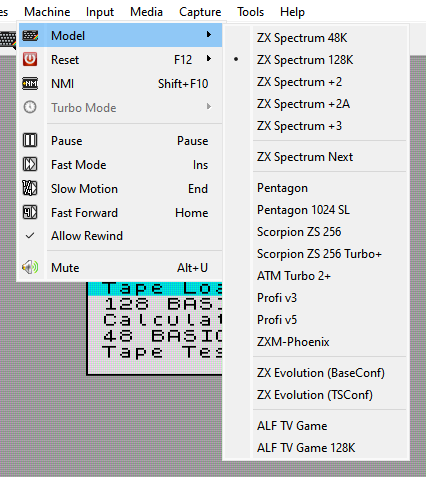
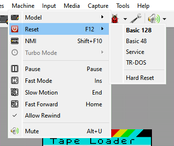

# Machine menu

```{index} machine
```

```{index} see: profile; machine
```

The **Machine** menu picks the machine and controls it: **Model**, **Reset**, **NMI**,
**Turbo Mode**, then **Pause**, **Fast Mode**, **Slow Motion**, **Fast Forward**,
**Allow Rewind**, and **Mute**. How each machine is set up is on the
[Machine page](options-machine.md) of **Options**.

Xpeccy+ comes with the Sinclair and Amstrad models of the ZX Spectrum, the ZX Spectrum Next,
the best-known clones and the ZX Evolution board. Each one is a complete machine: memory, ROM images, disk
interface, sound and timing are already set as on the real hardware.

## The built-in machines

```{index} machine; built-in, ZX Spectrum 48K, ZX Spectrum 128K, ZX Spectrum +2, ZX Spectrum +2A, ZX Spectrum +3, ZX Spectrum Next, Pentagon, Pentagon 1024 SL, Scorpion ZS 256, Scorpion ZS 256 Turbo+, ATM Turbo 2+, Profi v3, Profi v5, ZXM-Phoenix, ZX Evolution, ZX Evolution; BaseConf, ZX Evolution; TSConf, BaseConf, TSConf, ALF TV Game, ALF TV Game 128K, Robik
```

The machine list shows them in this order, in five groups.

| Machine | Memory | Disk | Notes |
|---|---|---|---|
| **ZX Spectrum 48K** | 48 KB | - | Sinclair's 48K; beeper only; cartridge slot |
| **ZX Spectrum 128K** | 128 KB | - | Sinclair's 128K; AY |
| **ZX Spectrum +2** | 128 KB | - | Amstrad's first model, the gray +2: the 128K with its own ROMs and late ULA timing; AY |
| **ZX Spectrum +2A** | 128 KB | - | Amstrad's later model: Amstrad gate array, four +3 ROMs; AY |
| **ZX Spectrum +3** | 128 KB | +3, two drives | the +2A with a 3-inch disk drive; AY |
| **ZX Spectrum Next** | 1024 or 2048 KB | - | a group of its own: Z80N up to 28 MHz, three AYs and DACs, divMMC and SD card, Wi-Fi; see [ZX Spectrum Next](zx-next.md) |
| **Robik** | 48 or 128 KB | - | a 48K clone of plain logic chips from Cherkasy: beeper on a piezo, Kempston joystick; Cyrillic ROM, 11 keys of its own, shadow RAM; see [Robik](#robik) |
| **Pentagon** | 128 KB | Beta Disk | YM, Covox; Kempston mouse and joystick |
| **Pentagon 1024 SL** | 1024 KB | Beta Disk | as the Pentagon; turbo x2, Gluk clock; starts Gluk Reset Service |
| **Scorpion ZS 256** | 256 KB | Beta Disk | AY, Covox; Kempston mouse and joystick |
| **Scorpion ZS 256 Turbo+** | 256 KB | Beta Disk | the Scorpion with the Turbo+ board: SMUC hard disk, turbo x2, ProfROM 4.44 |
| **ATM Turbo 2+** | 1024 KB | Beta Disk | YM, Covox; ATM hard disk, Kempston mouse and joystick, turbo x2 |
| **Profi v3** | 512 KB | Beta Disk | version 3 board; AY, Covox; Kempston mouse and joystick, turbo x2 |
| **Profi v5** | 1024 KB | Beta Disk | version 5 board; YM, Covox; Profi hard disk, DD palette, Kempston mouse and joystick, turbo x2 |
| **ZXM-Phoenix** | 2048 KB | Beta Disk | the board of revision 08.1 with the ROM made for revision 07: two YM (TurboSound); NemoIDE hard disk, SD card, clock, Kempston mouse with wheel and joystick, turbo x2 by a switch; see [ZXM-Phoenix](#zxm-phoenix) |
| **ZX Evolution (BaseConf)** | 4096 KB | Beta Disk | the ZX Evolution board running BaseConf: two YM (TurboSound), Covox; NemoIDE hard disk, SD card, PC keyboard, mouse with wheel, turbo x2 and x4 |
| **ZX Evolution (TSConf)** | 4096 KB | Beta Disk | the same board running TSConf; as BaseConf |
| **ALF TV Game** | 48 KB | - | a games console built on the 48K: no AY; cartridges, two joysticks |
| **ALF TV Game 128K** | 128 KB | - | the 128K version of the console; YM |

```{index} Beta Disk, TR-DOS
```

**Beta Disk** is the TR-DOS disk interface; the **+3** has its own drives and +3DOS (see
[Floppy disks](disks.md)).

On the clones and the +3 the disk interface is part of the board, and so are the hard disk
interfaces of the ATM Turbo 2+, the Profi v5 and the ZX Evolution: Options shows them, but
does not let you remove them.

A name with an asterisk after it in the list, such as `Pentagon *`, is a built-in machine
you have changed (see [Your own machines](options-machine.md#your-own-machines)).

## Model

```{index} machine; choosing, Model
```

Pick a machine in any of these places:

- **Machine > Model** on the menu bar;
- the {icon}`model-zx48` **Model** button on the toolbar;
- **Model** in the right-click menu over the picture;
- the machine's name in the status bar, with either mouse button;
- **Model** on the **Machine** page of **Options**, then **Apply**.



Switching machines resets the new machine and shows its name over the picture and in the
status bar. The tape and the disks stay in: the tape is rewound to its start. An RZX
recording stops, and the rewind history starts over.

In **Options**, pick the machine first and change its settings after: when **Apply**
switches the machine, what you changed on the **Machine** page is dropped, as it was for
the old machine. Changes on the other pages are applied to the new one. The page then
shows the new machine's settings.

Opening a file can switch the machine too, when the current one cannot run it. See
[Run a program](getting-started.md#run-a-program).

## Reset

```{index} Reset, Reset; ROM to start from
```

A click on **Machine > Reset** resets the machine. Its menu lists where a reset can take
the machine: the ROMs it can start from, such as **Basic 128**, **Basic 48**, **Service**
and **TR-DOS**. The one in bold is the ROM a plain reset starts from, with the reset key
beside it. **TR-DOS** is there only when the machine has a Beta Disk interface. On macOS a
click on **Reset** only opens the menu: the bold item is the plain reset there.



On the ATM Turbo 2+, the ZX Evolution, the ZX Spectrum Next and the ALF consoles the list
holds only **Soft Reset**: these machines start their own firmware on every reset.

The Pentagon 1024 SL starts from **Service**, Gluk Reset Service, as the board does. Gluk
looks at the keys held down as it starts: hold **S** and reset for its CMOS Setup, **F** for
its help. On the Pentagon set the plain reset to **Service** for the same.

With the [divMMC](divmmc.md) on, a plain reset starts **Basic 128** instead, on both. Gluk and
the divMMC cannot work together: the divMMC switches its own memory in whenever the
processor runs code at certain addresses at the start of the ROM, and Gluk runs code at two
of them (#0008 and #0038) as it starts. esxDOS then takes over in the middle of Gluk, and the
machine hangs. **Service** in the list still starts Gluk, with this result.

The {icon}`shutdown` **Reset** button on the toolbar resets the machine when clicked; the
arrow beside it opens the list. **Reset** in the right-click menu works the same way. F12
resets in both hotkey presets.

To change the ROM a plain reset starts from, click the {icon}`settings` **ROM** button on
the **Machine** page of **Options** and mark another ROM (see [ROM images](options-machine.md#rom-images)).

```{index} Hard Reset, power off and on
```

**Hard Reset**, at the end of the list, switches the machine off and on again. Nothing of
what ran before is left: the RAM comes up as the machine's does at power-on (cleared where
the machine's power-on pattern is not known), and so do a [divMMC](divmmc.md) and a General
Sound card, which a reset leaves as they are. A program that keeps its state across a
reset, as the Scorpion's service monitor does, starts afresh. The CMOS memory, an EEPROM
and the media keep what they hold. A switch to another machine is a power-on too.

```{index} Reset to 48K, Reset to 128K, Reset to DOS, Reset to Service
```

The **Hotkeys** page of **Options** also has **Reset to 48K**, **Reset to 128K**,
**Reset to DOS**, **Reset to Service** and **Hard Reset**, with no keys set to start with.
On a machine that cannot start from that ROM, the key only shows a short message.

## NMI

```{index} NMI
```

{icon}`grp-nmi` **NMI** on the toolbar, or **Machine > NMI**, sends a non-maskable
interrupt to the CPU. What happens then is up to the
machine's ROM. It does nothing while an RZX recording plays. The key is F10 in the Classic
preset and Shift+F10 in the Modern one. With a [divMMC](divmmc.md) on, it is the
board's NMI button. On the ZX Spectrum Next it is the yellow NMI button on its side (see
[ZX Spectrum Next](zx-next.md)).

The button is held down as long as its key is, and for three frames at least after a click.
On the machines with a Beta Disk interface (the Scorpion, the Pentagon and the other clones) it
is the "magic" button, and as on the real board the NMI comes only when the program runs in
RAM: from 128 BASIC or a game it lands, from 48 BASIC or the TR-DOS prompt it never does.
Held down, it comes again each time the program gets back into RAM.

## Turbo Mode

```{index} Turbo Mode, turbo, Switch Turbo
```

**Machine > Turbo Mode** lists the turbo steps the machine's board has, with the CPU clock
each one gives, for example **x2 (7 MHz)**. It is grayed out on a machine with no turbo, and
while an RZX recording plays. The **Switch Turbo** hotkey steps through the list.

A board that has a turbo usually lets programs switch the turbo too. Then a program can
change the step you picked, and Xpeccy+ shows the new clock over the picture.

On the Pentagon 1024 SL, Gluk Reset Service runs its own menu at 7 MHz and sets the turbo
again every time it reads its clock, so the turbo cannot be switched while the menu is on the
screen. The programs it starts run at the speed its **W** key picks: **Fast** (7 MHz) or
**Slow** (3.5 MHz), shown at the top of its menu. Gluk keeps the choice in the clock chip; a
new machine starts with **Slow**.

On the ZXM-Phoenix the turbo is a switch on the case, which no program can reach, and
**Turbo Mode** is that switch. The board drops to 3.5 MHz by itself while TR-DOS works and
goes back to 7 MHz after it.

The **Overclock** slider of the **Machine** page of **Options** runs the CPU faster still,
on any machine; see [Overclock](options-machine.md#overclock).

## ZXM-Phoenix

```{index} ZXM-Phoenix, Fatall, TR-DOS 6.11Q
```

The ZXM-Phoenix is a clone built of plain logic chips by Mick (Mick Laboratory) since 2009:
the memory of a KAY and of a Scorpion, up to 2048 KB, and a frame of its own, 312 lines of
224 ticks. Its border changes color only every eight pixels, so border pictures made for a
Pentagon look different on it, as on the real board; programs written for the Phoenix draw
theirs right only here.

The machine is the board of revision 08.1 and starts the ROM made for revision 07: a menu
with **Fatall 0.25** by savelij, a file manager for the SD card and the hard disk, TR-DOS
6.11Q, whose drive D is a RAM disk, and both BASICs. On the board are a Beta Disk
interface, a NemoIDE hard disk interface, an SD card slot, a clock on the
[Gluk clock](options-machine.md#the-gluk-clock)'s ports, two YM chips as TurboSound, a
Kempston mouse and a Kempston joystick.

In the **Memory** list of the [Machine page](options-machine.md), **1024 KB** is the board
with one memory module and **128 KB** the board with its 128 KB jumper closed, for programs
that set the memory ports carelessly. The older ROM of these boards, BIOS 5.03, is
`phoenix.rom` in the ROM folder: pick it as the machine's ROM to run it.

## Robik

```{index} Robik, shadow RAM; Robik, BRIGHT; Robik, cell edges; Robik
```

The Robik is a ZX Spectrum 48K built of plain logic chips by NPO Rotor in Cherkasy. Its ROM,
version V03, is the 48K's BASIC with Cyrillic letters and a keyboard of 64 keys; it starts
in white on blue with "© "SELTO-ROTOR" Computer V03". Its frame is its own, 313 lines of 212
ticks, and nothing in it is contended but a write to the screen's memory, #4000-#5FFF, which
waits from 1 to 4 ticks; the timings were measured on three owners' boards.

Three things differ from board to board, and the **Board features** group of the
[Machine page](options-machine.md) of **Options** has a row for each:

- **Shadow RAM**: 16 KB of RAM under the ROM. Any OUT or IN on port 15 swaps the ROM and
  this RAM, and a write to the ROM's addresses always goes into the RAM, so a ROM loaded
  into memory can be copied there and switched in - the owners did so with the 48K's ROM
  for programs the Robik's own does not run. Reset brings the ROM back; the RAM keeps its
  bytes until the power goes. **Port #0F (Robik)** by default, **Off** for a board without
  it.
- **BRIGHT**: the factory board does not wire BRIGHT, so every color is bright, the border's
  too (**All bright**, the default). **Two levels** is the owners' jumper: bright and normal,
  as on a 48K.
- **Cell edges**: most boards show a thin line, half a pixel wide, where a character cell's
  colors differ from the one before it - pixels of the new cell drawn for a moment in the old
  colors. On by default.

Owners took some boards to 128 KB, with an AY and a Kempston mouse beside them. **128 KB** in
the **Memory** list is such a board: port #7FFD pages memory as on a Pentagon 128, and the ROM
is a Pentagon 128's pair, its menu with a TR-DOS item (**Basic 128**) and the 48K BASIC that
menu runs, as the Robik's own ROM cannot stand in for it. The frame, the clock and the wait
stay the Robik's; a write into either screen, page 5 or page 7, waits wherever the page is.
How such a board switched its shadow RAM is not known, so it has none: **Shadow RAM** is
grayed. The AY and the mouse are picked on the same page, at any memory size.

The 11 keys of its own (Х, Ж, Э, Б, Ю, comma, period, EDIT, DELETE and the language keys C
and L) are on the PC keys at their places on the Robik's case in the keyboard layout
**Robik** (see [Keymaps](input.md#keymaps)): Tab is EDIT, Backspace DELETE, `-` the
period, `/` the comma, `[` Х, `;` Ж, `'` Э, `,` Б, `.` Ю, Right Alt C and Right Ctrl L.

Not yet known: whether the piezo also sounds the tape output.

## Pause, Fast Mode, Slow Motion, Fast Forward, Allow Rewind

These change how fast the machine runs, and let it go back in time; see
[Speed and time](time.md).

## Mute

```{index} Mute, volume
```

{icon}`speaker` **Mute** on the toolbar, or **Machine > Mute**, silences the sound and
brings it back. The arrow beside the **Mute** button opens a slider for the volume, the
**Board filter**'s choices and the **Output filters**, **Low cut** and **High cut** (see
[Toolbar](toolbar.md) and [Board filter](options-sound.md#board-filter)). **Sound** in the
right-click menu has **Mute** and the same filters.

Alt with the mouse wheel over the picture turns the volume up or down by 5%. The slider
under the **Mute** button shows the new volume for a moment; when the toolbar is hidden,
the volume is shown over the picture. While the mouse is grabbed, the wheel goes to the
machine instead.

This volume is the same as **Master** on the **Sound** page, and both mute and volume
are kept for the next start.

```{toctree}
:maxdepth: 2

zx-next
time
```
