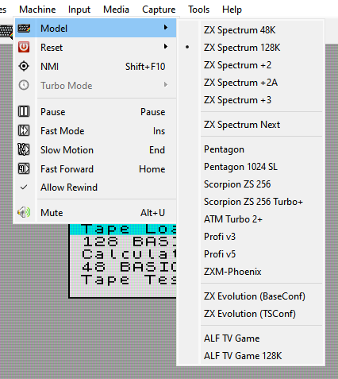

# Machine menu

```{index} machine
```

```{index} see: profile; machine
```

The **Machine** menu picks the machine and controls it: **Model**, **Reset**, **NMI**,
**Turbo Mode**, then **Pause**, **Fast Mode**, **Slow Motion**, **Fast Forward**,
**Allow Rewind**, and **Mute**. How each machine is set up is on the
[Machine page](options-machine.md) of **Options**.

Xpeccy+ comes with the Sinclair and Amstrad models of the ZX Spectrum, the ZX Spectrum Next,
the best-known clones and the ZX Evolution board. Each one is a complete machine: memory, ROM images, disk
interface, sound and timing are already set as on the real hardware.

## The built-in machines

```{index} machine; built-in, ZX Spectrum 48K, ZX Spectrum 128K, ZX Spectrum +2, ZX Spectrum +2A, ZX Spectrum +3, ZX Spectrum Next, Pentagon, Pentagon 1024 SL, Scorpion ZS 256, Scorpion ZS 256 Turbo+, ATM Turbo 2+, Profi v3, Profi v5, ZXM-Phoenix, ZX Evolution, ZX Evolution; BaseConf, ZX Evolution; TSConf, BaseConf, TSConf, ALF TV Game, ALF TV Game 128K
```

The machine list shows them in this order, in five groups.

| Machine | Memory | Disk | Notes |
|---|---|---|---|
| **ZX Spectrum 48K** | 48 KB | - | Sinclair's 48K; beeper only; cartridge slot |
| **ZX Spectrum 128K** | 128 KB | - | Sinclair's 128K; AY |
| **ZX Spectrum +2** | 128 KB | - | Amstrad's first model, the gray +2: the 128K with its own ROMs and late ULA timing; AY |
| **ZX Spectrum +2A** | 128 KB | - | Amstrad's later model: Amstrad gate array, four +3 ROMs; AY |
| **ZX Spectrum +3** | 128 KB | +3, two drives | the +2A with a 3-inch disk drive; AY |
| **ZX Spectrum Next** | 2 MB | - | a group of its own: Z80N up to 28 MHz, three AYs and DACs, divMMC and SD card, Wi-Fi; see [ZX Spectrum Next](zx-next.md) |
| **Pentagon** | 128 KB | Beta Disk | YM, Covox; Kempston mouse and joystick |
| **Pentagon 1024 SL** | 1024 KB | Beta Disk | as the Pentagon; turbo x2 |
| **Scorpion ZS 256** | 256 KB | Beta Disk | AY, Covox; Kempston mouse and joystick |
| **Scorpion ZS 256 Turbo+** | 256 KB | Beta Disk | the Scorpion with the Turbo+ board: SMUC hard disk, turbo x2 |
| **ATM Turbo 2+** | 1024 KB | Beta Disk | YM, Covox; ATM hard disk, Kempston mouse and joystick, turbo x2 |
| **Profi v3** | 512 KB | Beta Disk | version 3 board; AY, Covox; Kempston mouse and joystick, turbo x2 |
| **Profi v5** | 1024 KB | Beta Disk | version 5 board; YM, Covox; Profi hard disk, DD palette, Kempston mouse and joystick, turbo x2 |
| **ZXM-Phoenix** | 2 MB | Beta Disk | YM, Covox; Kempston mouse and joystick, turbo x2 |
| **ZX Evolution (BaseConf)** | 4 MB | Beta Disk | the ZX Evolution board running BaseConf: two YM (TurboSound), Covox; NemoIDE hard disk, SD card, PC keyboard, mouse with wheel, turbo x2 and x4 |
| **ZX Evolution (TSConf)** | 4 MB | Beta Disk | the same board running TSConf; as BaseConf |
| **ALF TV Game** | 64 KB | - | a games console built on the 48K: no AY; cartridges, two joysticks |
| **ALF TV Game 128K** | 128 KB | - | the 128K version of the console; YM |

```{index} Beta Disk, TR-DOS
```

**Beta Disk** is the TR-DOS disk interface; the **+3** has its own drives and +3DOS (see
[Floppy disks](disks.md)).

On the clones and the +3 the disk interface is part of the board, and so are the hard disk
interfaces of the ATM Turbo 2+, the Profi v5 and the ZX Evolution: Options shows them, but
does not let you remove them.

A name with an asterisk after it in the list, such as `Pentagon *`, is a built-in machine
you have changed (see [Your own machines](options-machine.md#your-own-machines)).

## Model

```{index} machine; choosing, Model
```

Pick a machine in any of these places:

- **Machine > Model** on the menu bar;
- the {icon}`model-zx48` **Model** button on the toolbar;
- **Model** in the right-click menu over the picture;
- the machine's name in the status bar, with either mouse button;
- **Model** on the **Machine** page of **Options**, then **Apply**.



Switching machines resets the new machine and shows its name over the picture and in the
status bar. The tape and the disks stay in: the tape is rewound to its start. An RZX
recording stops, and the rewind history starts over.

In **Options**, pick the machine first and change its settings after: when **Apply**
switches the machine, what you changed on the **Machine** page is dropped, as it was for
the old machine. Changes on the other pages are applied to the new one. The page then
shows the new machine's settings.

Opening a file can switch the machine too, when the current one cannot run it. See
[Run a program](getting-started.md#run-a-program).

## Reset

```{index} Reset, Reset; ROM to start from
```

**Machine > Reset** lists where a reset can take the machine: the ROMs it can start from,
such as **Basic 128**, **Basic 48**, **Service** and **TR-DOS**. The one in bold is the ROM
a plain reset starts from. **TR-DOS** is there only when the machine has a Beta Disk
interface.


On the ATM Turbo 2+, the ZX Evolution and the ALF consoles the list holds only **Boots its
own firmware**, grayed out: these machines start their own firmware on every reset.

The {icon}`shutdown` **Reset** button on the toolbar resets the machine when clicked; the
arrow beside it opens the list. **Reset** in the right-click menu works the same way. F12
resets in both hotkey presets.

To change the ROM a plain reset starts from, click the {icon}`settings` **ROM** button on
the **Machine** page of **Options** and mark another ROM (see [ROM images](options-machine.md#rom-images)).

```{index} Hard Reset, power off and on
```

**Hard Reset**, at the end of the list, switches the machine off and on again. The RAM
comes up as the machine's does at power-on, and so does a [divMMC](divmmc.md), which a
reset leaves as it is. The CMOS memory, an EEPROM and the media keep what they hold.

```{index} Reset to 48K, Reset to 128K, Reset to DOS, Reset to Service
```

The **Hotkeys** page of **Options** also has **Reset to 48K**, **Reset to 128K**,
**Reset to DOS**, **Reset to Service** and **Hard Reset**, with no keys set to start with.
On a machine that cannot start from that ROM, the key only shows a short message.

## NMI

```{index} NMI
```

**Machine > NMI** sends a non-maskable interrupt to the CPU. What happens then is up to the
machine's ROM. It does nothing while an RZX recording plays. The key is F10 in the Classic
preset and Shift+F10 in the Modern one. With a [divMMC](divmmc.md) on, it is the
board's NMI button.

## Turbo Mode

```{index} Turbo Mode, turbo, Switch Turbo
```

**Machine > Turbo Mode** lists the turbo steps the machine's board has, with the CPU clock
each one gives, for example **x2 (7 MHz)**. It is grayed out on a machine with no turbo, and
while an RZX recording plays. The **Switch Turbo** hotkey steps through the list.

A board that has a turbo usually lets programs switch the turbo too. Then a program can
change the step you picked, and Xpeccy+ shows the new clock over the picture.

The **Overclock** slider of the **Machine** page of **Options** runs the CPU faster still,
on any machine; see [Overclock](options-machine.md#overclock).

## Pause, Fast Mode, Slow Motion, Fast Forward, Allow Rewind

These change how fast the machine runs, and let it go back in time; see
[Speed and time](time.md).

## Mute

```{index} Mute, volume
```

{icon}`speaker` **Mute** on the toolbar, or **Machine > Mute**, silences the sound and
brings it back. The arrow beside the **Mute** button opens a slider for the volume (see
[Toolbar](toolbar.md)).

Alt with the mouse wheel over the picture turns the volume up or down by 5%. The slider
under the **Mute** button shows the new volume for a moment; when the toolbar is hidden,
the volume is shown over the picture. While the mouse is grabbed, the wheel goes to the
machine instead.

This volume is the same as **Master** on the **Sound** page, and both mute and volume
are kept for the next start.

```{toctree}
:maxdepth: 2

zx-next
time
```
