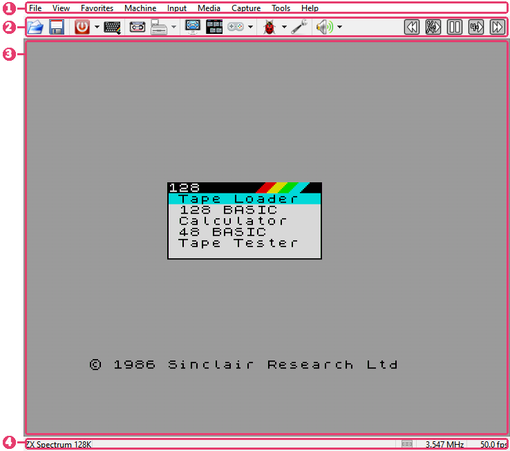

# The main window

```{index} main window
```



1. **Menu bar** - every command, with its key beside it.
2. **Toolbar** - the commands you use most, one click away.
3. **Picture** - the machine's screen. Short messages from the program appear in its
   lower left corner and fade away.
4. **Status bar** - the machine, its tape and drives, speed.

The menus are described in [Menu bar](menu-bar.md), the buttons in
[Toolbar](toolbar.md), and the menu a right-click on the picture opens in
[Right-click menu](context-menu.md).

## Status bar

```{index} status bar, status bar; tape, status bar; drive lights
```


1. the name of the running machine; a click or a right-click on it opens the list of
   machines;
2. {icon}`tapeGreen` **tape** - the tape light, the block being played (`3/7`) and how far
   the tape is through that block;
3. {icon}`diskGreen` **A: B: C: D:** - a light for each floppy drive the machine has;
4. {icon}`joystick` **joystick** and {icon}`mouse` **mouse** - lit while the running
   program reads them;
5. the CPU clock in MHz;
6. frames per second, or **paused**.

The tape and the drives light up the same way: dim - nothing is in, gray - a tape or a disk
is in, green - reading, red - writing. While it reads or writes, a light blinks: the tape's
between its color and a brighter one all the time it moves, a drive's each time its head
steps to another track.

Hold the mouse over the tape or a drive to see which file is in it. A click opens the
**Tape Player** or the **Disk Manager**; a right-click opens a short menu of the same
commands - play, rewind, open, eject.


While a [divMMC](divmmc.md) is on, the {icon}`sdcard` **SD** light is the light of its
cards - dim with no card in, blue with one, green while one is read, red while one is
written - and either button on it
opens a menu of its cards. The board itself is switched off from the **Media** menu. The
drives are out of the machine then:
their lights are dim and struck through.

### Frames per second

```{index} FPS, frames per second
```

The status bar shows how many frames a second the machine actually runs at. With the
status bar hidden, tick **FPS** in the **Indicators** group on the **Appearance** page of
**Options** to see the number in the top right corner of the picture.

## The picture

```{index} picture; mouse
```

- A right-click opens the [right-click menu](context-menu.md).
- Drop a file onto the picture to open it (see [Run a program](getting-started.md#run-a-program)).
- A click with the middle button grabs the mouse for a program that uses one; another
  click lets the mouse go.
- Alt with the mouse wheel changes the volume.

## Fullscreen

```{index} Fullscreen, Fullscreen; menu bar
```

**View > Fullscreen** hides the menu bar, the toolbar and the status bar. Push the pointer
to the top edge of the screen and hold it there: the menu bar comes down, with the toolbar
if it is shown. They go away again a moment after the pointer leaves them. On macOS the menu
is in the system menu bar, as usual.
