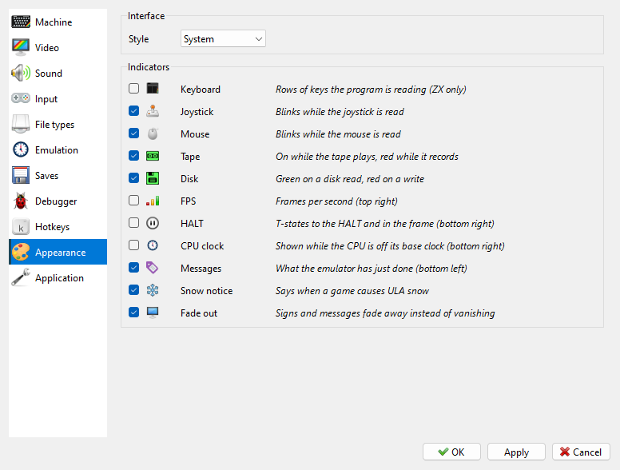

# Appearance page

```{index} Appearance page, Style, interface style
```



- **Interface** - **Style**: **System** (the look of your system) or one of seven bundled
  styles.
- **Indicators** - which signs are shown over the picture. See
  [Indicators on the picture](#indicators-on-the-picture).

## Indicators on the picture

```{index} Indicators, CPU clock, HALT indicator, Fade out, Snow notice
```

The **Indicators** group on the **Appearance** page of **Options** sets what is drawn
over the picture. Tick the ones you want:

| Indicator | What it shows |
|---|---|
| **Keyboard** | the rows of keys the program is reading (ZX machines only) |
| **Joystick** | blinks while the joystick is read |
| **Mouse** | blinks while the mouse is read |
| **Tape** | on while the tape plays, red while it records |
| **Disk** | green when a disk is read, red when it is written |
| **FPS** | frames per second, top right |
| **HALT** | the T-states up to the HALT and in the whole frame, bottom right |
| **CPU clock** | the clock in MHz, bottom right, while the CPU is not on its base clock - turbo or overclock |
| **Messages** | what Xpeccy+ has just done, bottom left: "size x3", "quick save" and so on |
| **Snow notice** | the message, falling snow and blinking snowflake when a game causes ULA snow (see [When a game snows](ula-snow-floating-bus.md#when-a-game-snows)); the snow itself stays |
| **Fade out** | signs and messages fade away instead of vanishing at once |

**Joystick**, **Mouse**, **Tape**, **Disk**, **FPS** and **CPU clock** are drawn on the
picture only while the status bar is hidden; with the status bar shown, they are in the
status bar instead (see [Status bar](main-window.md#status-bar)).

In the top right corner a sign also shows the speed mode, in the manner of a video
recorder: pause, rewind with how many seconds back, fast mode, fast forward or slow
motion (see [Speed and time](time.md)).
