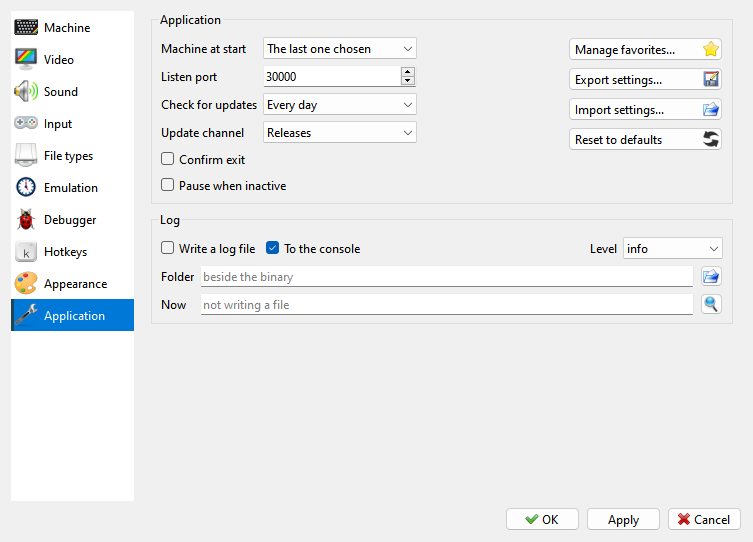

# Application page

```{index} Application page, Listen port, Check for updates, Update channel, Confirm exit, Export settings, Import settings, Reset to defaults, log, log file
```



- **Machine at start** - see [Machine at start](#machine-at-start).
- **Listen port** - the network port the program listens on, for tools that control it.
- **Check for updates**, **Update channel** - how often to look for a newer version, and
  whether nightly builds count; see [Updates](getting-started.md#updates).
- **Confirm exit** - ask before closing.
- **Pause when inactive** - pause the machine while the window is in the background. See
  [Pause](time.md#pause).
- {icon}`star` **Manage favorites...** - see [Favorites menu](favorites.md).
- {icon}`save-as` **Export settings...**, {icon}`fileopen` **Import settings...** - keep all
  your settings, your own machines included, in one file, and bring them back.
- {icon}`refresh` **Reset to defaults** - puts every setting back to its default value. Your
  own machines stay.
- **Log** - a log file of what the program does, for reporting a problem: **Write a log
  file**, **To the console**, **Level**, **Folder**.

## Machine at start

```{index} Machine at start, Start Machine
```

**Machine at start** on the **Application** page of **Options** sets which machine Xpeccy+
starts with:

- **The last one chosen** - the last machine you picked yourself. A machine that a file
  switched to does not count.
- **Ask** - the **Start Machine** window asks every time.
- one of the machines - always that one.

At the first start you are asked
(see [The first start](getting-started.md#the-first-start)). When a machine or a file is
named on the command line, the question is skipped (see [Command line](command-line.md)).
