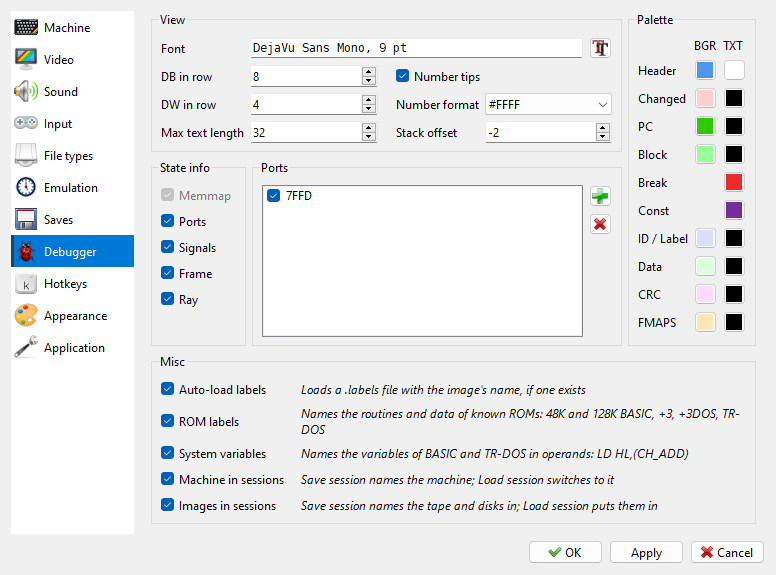

# Debugger page

```{index} Debugger page
```



The font, the colors and what the Debugger shows.

```{index} Debugger; font, Debugger; colors, State info, DB in row, DW in row, Max text length, Number format, Numbers (Debugger), Number tips
```

**View**:

- **Font** - the font of all the Debugger's panels. The {icon}`font` button beside it
  picks one. The menus keep the font of the rest of the program.
- **DB in row**, **DW in row**, **Max text length** - how many bytes, words or characters
  one line of the listing holds when it shows data instead of code. See
  [Disasm panel](debugger-code.md).
- **Number tips** - a number's hex, decimal and binary in a tip when the mouse rests on
  it: in the listing and the dumps. On by default. See
  [Typing a number](debugger-code.md#typing-a-number).
- **Number format** - how addresses and the numbers of the listing are written: `#FFFF`,
  `$FFFF`, `FFFFh` or decimal `65535`. The button on the listing's toolbar and
  Ctrl+Shift+H switch between hex in the form picked here and decimal. See
  [Hex or decimal](debugger-code.md#hex-or-decimal).
- **Stack offset** - where the **STACK** panel starts, from -16 to 16 bytes from SP. See
  [STACK panel](debugger-stack.md).

**State info** - which blocks the **MEMMAP** panel shows: **Ports**, **Signals**, **Frame**
and **Ray**. **Memmap** cannot be switched off: the panel's title bar, which you drag the
panel by, is part of it.

**Ports** - the watched ports of the machine that is running. See
[Watched ports](debugger-memmap.md#watched-ports).

**Palette** - the Debugger's own colors, each with a background (**BGR**) and a text
(**TXT**) color. Click a color to change it; right-click it to go back to the color of
the interface style.

| Color | Where it is used |
|---|---|
| **Header** | the title bars of the panels and the block names of **MEMMAP** |
| **Changed** | a value that changed in the last step |
| **PC** | the line of the listing at PC |
| **Block** | a selected block in the listing and the dump |
| **Break** | the lines that have a breakpoint |
| **ID / Label** | the ID field of a disk track, and labels in the listing |
| **Data** | the data of a disk sector |
| **CRC** | the checksums on a disk track |
| **Const** | constants in the listing |
| **FMAPS** | the TSConf FMAPS window in the dump and **MEMMAP** |

Choosing another interface style on the **Appearance** page puts these colors back to that
style's own.

**Misc** - **Auto-load labels**: opening an image also loads a `.labels` file of the same
name, if there is one. See [Disasm panel](debugger-code.md). **ROM labels**: known ROMs
name their routines in the listing and show their data as data. **System variables**: the
variables of BASIC and TR-DOS are named in instructions, `LD HL,(CH_ADD)`. See
[ROM labels](debugger-code.md#rom-labels). **Machine in sessions**: **Save session** names
the machine, and **Load session** switches to it. **Images in sessions**: **Save session**
names the tape and the disks in the machine, and **Load session** puts them in. See
[Sessions](debugger-code.md#sessions).
