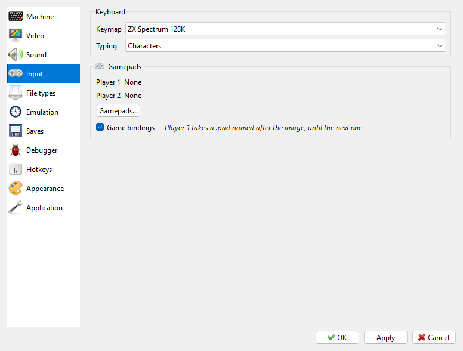

# Input page

```{index} Input page
```



The keymap and **Typing**: **Characters** has a symbol key type the symbol printed on it,
Shift+`;` giving `:`; **Key Positions** keeps Shift as Caps Shift on every key. Then the
gamepads of **Player 1** and **Player 2**, with the **Gamepads...** button that opens their
window; and **Game bindings**.
See [Input menu](input.md).
