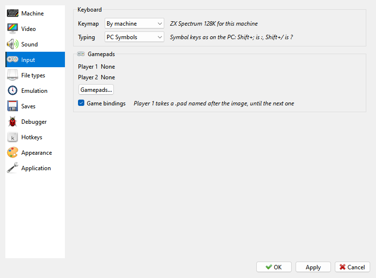

# Input page

```{index} Input page
```



The keymap, with what it does beside it: **By machine**, the default, names the one the
current machine takes. Then **Typing**: **PC Symbols** has the symbol keys
type what is printed on them, Shift+`;` giving `:`; **Key Positions** keeps Shift as Caps
Shift with every key. Then the gamepads of **Player 1** and **Player 2**, with the **Gamepads...** button that opens their
window; and **Game bindings**.
See [Input menu](input.md).
