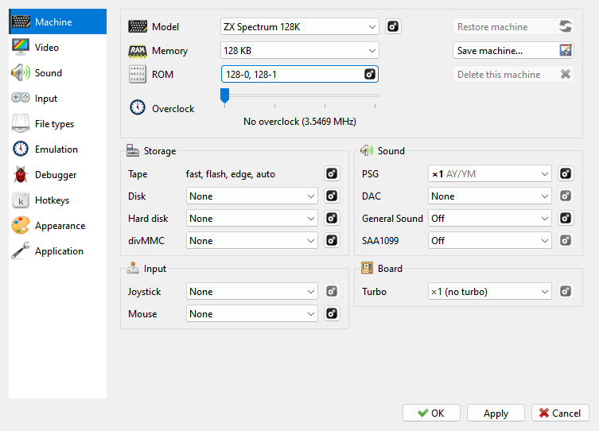

# Machine page

```{index} Machine page
```



This page sets up the running machine: **Model**, **Memory**, **ROM** and the **Overclock**
slider at the top, then its devices in four groups - **Storage**, **Input**, **Sound** and
**Board**. The {icon}`settings` gear beside a device opens the rest of its settings.

What you change here is kept for this machine only. {icon}`save_all` **Save machine...**,
{icon}`refresh` **Restore machine** and {icon}`cancel` **Delete this machine** are explained
in [Your own machines](#your-own-machines).

```{index} Memory
```

**File > Options...** opens **Options**; **Machine** is its first page. At the top:

- **Model** - the machine. The {icon}`settings` gear beside it opens
  **Machine: Advanced Settings**.
- **Memory** - how much RAM the machine has.
- **ROM** - the ROM files in use; the {icon}`settings` button opens **Machine: ROM**.
- **Overclock** - the slider described in [Overclock](#overclock).
- {icon}`refresh` **Restore machine**, {icon}`save_all` **Save machine...**,
  {icon}`cancel` **Delete this machine** - see [Your own machines](#your-own-machines).

```{index} machine; devices, Covox, Soundrive, General Sound, SAA1099
```

Below them are the machine's devices, in four groups. Each row has a choice and a
{icon}`settings` gear button; the gear opens the rest of that device's settings, in a window
named after it, such as **Machine: Disk**. A gray gear means the device has nothing more to
set. **OK** closes such a window and keeps what you set in it for **Apply**; **Cancel** (or
Esc) puts back what it showed when it opened.

| Group | Row | What it sets |
|---|---|---|
| **Storage** | **Tape** | loading settings; the row shows which are on (see [Tapes](tapes.md)) |
| | **Disk** | **None**, **Beta Disk (WD1793)** or **+3 (uPD765)**; drives and the TR-DOS ROM in its window (see [Floppy disks](disks.md)) |
| | **Hard disk** | the IDE interface; **Master** and **Slave** in its window (see [Hard disks](sd-hdd.md#hard-disks)) |
| | **SD card** | ZX Evolution and ZX Spectrum Next only: the card in use (for the Next, see [The SD card](zx-next.md#the-sd-card)) |
| | **divMMC** | 48K, 128K, +2, +2A, +3 and the Pentagons: **None** or **divMMC**; RAM, EEPROM jumper and the firmware in its window (see [divMMC](divmmc.md)) |
| | **Cartridge** | 48K and ALF only: the cartridge in use |
| **Input** | **Joystick** | **None**, **Kempston 5-bit**, **Kempston 8-bit** |
| | **Mouse** | **None** or **Kempston mouse**; sensitivity and wheel in its window (see [Mouse](input.md#mouse)) |
| | **PC keyboard** | ATM Turbo 2+ and ZX Evolution only: which scan codes the machine gets (see [Machines with a keyboard of their own](input.md#machines-with-a-keyboard-of-their-own)) |
| **Sound** | **PSG** | the AY/YM chips, from **None** to **x3 - ZX Next**; chip, clock and stereo in its window (see [PSG](#psg)) |
| | **DAC** | **None**, **Covox only**, **Soundrive 1.05 mode 1** or **mode 2** |
| | **General Sound** | **Off** or **On**; its ROM in its window |
| | **SAA1099** | **Off** or **On** |
| **Board** | **Turbo** | the turbo steps: **x1 (no turbo)**, **x1, x2** or **x1, x2, x4** |
| | **ESP UART** | ZX Spectrum Next only: **Not connected**, **ESP-01 (emulated)** - the Wi-Fi module with Espressif's AT firmware 1.7.6, on this computer's network - or a serial port of this computer with a real module on it. In its window, **Server on the network** lets other computers reach a server the module opens, and a UDP link's own port; off, only this computer reaches the server, at 127.0.0.1, and a UDP link hears only whom it sent to. On, Windows asks once whether to let Xpeccy+ through its firewall |
| | **Pi UART** | ZX Spectrum Next only: a serial port of this computer for the Pi's UART |

Changes take effect when you press **Apply** or {icon}`ok-apply` **OK**.

## Overclock

```{index} Overclock slider, Overclock, Overclock Up, Overclock Down
```

**Overclock** on the **Machine** page of **Options** is a slider for the CPU's clock:
**No overclock**, then **Overclock x2**, **x4** and **x8**. The CPU runs faster, while the
frame rate stays where it was. To slow the whole machine down or speed it up, frames and
sound included, use **Slow Motion** and **Fast Forward** (see [Speed and time](time.md)).

No real machine ran faster than 14 MHz, so past that the timing of a program is not
guaranteed. The slider is not saved: the next start is without overclock. The
**Overclock Up** and **Overclock Down** hotkeys move it too.

## Advanced settings

```{index} Machine: Advanced Settings, Base clock, Raster layout, Floating bus, Contended memory, contention, ULA snow, ULA plus
```

**Machine: Advanced Settings** holds the settings of the hardware itself, not of how you use
it. Leave them alone unless you know the hardware.

- **CPU** - **Base clock**, the frequency of the crystal the board runs on. The frame rate
  is derived from it too.
- **ULA** - **Raster layout** (the size of the frame and where the interrupt falls in it),
  **ULA pattern**, **Floating bus**, **Ear input**, and check boxes for **Contended memory**,
  **Contended I/O**, **Early timings**, **4T border**, **ULA snow...**,
  **...and it crashes**, **MIC in the beeper** and **ULA plus**.
- **Board** - **Even M1** (Scorpion ZS 256) and **DD palette** (Profi).

Each one is explained beside it, or in a tooltip when you hold the mouse over it.

## Machine: Tape

```{index} tape; settings, Machine: Tape
```

On the **Machine** page of **Options**, the **Storage** group has a **Tape** row. It sums
up the settings: **plain**, or the ones that are on: **fast**, **flash**, **edge**,
**auto**. By default all four are on. The {icon}`settings` button at the end of the
row opens the **Machine: Tape** sheet:

- **Playback speed**;
- **Auto play / stop**;
- **Rewind at end**;
- **Fast loading**, **Flash loading** and **Edge detection**.

The first four are the same settings as in the **Tape Player**, where a change takes
effect at once.

The tape's loudness is **Tape** in the **Volumes** group of the **Sound** page (see
[Sound page](options-sound.md)).

## Machine: Disk

```{index} Machine: Disk, Interleave, Number of drives, TR-DOS ROM
```

The {icon}`settings` gear in the **Disk** row of the **Machine** page opens
**Machine: Disk**:

- **Fast disk access** - no waiting for the head to move or the disk to turn; see
  [Fast Disk Access](disks.md#fast-disk-access).
- **Add boot loader** - see [The boot file](disks.md#the-boot-file).
- **TR-DOS ROM** - which ROM image the Beta Disk runs.
- **Interleave** - the order of sectors on each track of a `.trd` or `.scl` image, set when
  the image is opened. TR-DOS formats its own disks as 1, 9, 2, 10...
- **Number of drives** - from one (A) to four (A to D); a +3 has two at most. A drive left
  out is not there at all, and programs find it missing.
- **Drives** - for each drive, **80 cylinders** and **Double side**.

## Sound devices

```{index} sound devices
```

The **Sound** group on the **Machine** page of **Options** lists the sound devices of
the running machine. Each machine keeps its own devices: a change here applies to this
machine only. The button with the {icon}`settings` gear at the end of a row opens the
device's further settings. How loud each device plays is set on the
[Sound page](options-sound.md).

### PSG

```{index} PSG, AY, YM, TurboSound, TurboSound FM
```

```{index} see: sound chip; PSG
```

The PSG is the sound chip most music on the Spectrum is written for. The **PSG** row sets
how many of them the machine has:

| Choice | What you get |
|---|---|
| **None** | no sound chip |
| **x1 - AY/YM** | one chip, three voices - the 128K machines and most clones |
| **x2 - TurboSound** | two chips, six voices, for music written for TurboSound |
| **x2 - TurboSound FM** | two YM2203 chips: TurboSound with FM synthesis, for music written for TurboSound FM |
| **x3 - ZX Next** | three chips, nine voices |

A program written for one chip plays on the first chip of two or three, and sounds the
same.

```{index} Machine: PSG, AY-3-8910, YM2149, YM2203, PSG; clock, PSG; stereo, Separation
```

The {icon}`settings` gear opens **Machine: PSG**:

- **Chip** - **AY-3-8910** or **YM2149**. The two sound alike; the YM2149 plays volume
  envelopes in finer steps. **YM2203** is the chip of TurboSound FM: choosing
  **x2 - TurboSound FM** sets it, and the list is then grayed out.
- **Clock** - the chip's clock in MHz, which sets the pitch. **Auto** is half the
  machine's base CPU clock, as the boards divide it, and the list shows the resulting
  value. **1.773447** is the clock of the ZX Spectrum 128, +2 and +3; **1.75** that of
  most clones. Music written for one of them sounds a little out of tune on the other.
  You can also type a clock of your own.
- **Stereo** - **Mono**, or the order of the three voices from left to right: **ABC**,
  **ACB**, **BAC**, **BCA**, **CAB**, **CBA**. **ABC** puts the second voice in the
  middle; **ACB** puts the third voice there.
- **Separation** - how far apart the left and right sides are: 100% keeps them fully
  apart, 0% is mono. It is grayed out with **Mono**.

### DAC

```{index} DAC, Covox, Soundrive
```

A DAC plays digitized sound - speech, drums and samples - written to a port byte by
byte:

- **None** - no DAC;
- **Covox only** - one mono channel on port #FB;
- **Soundrive 1.05 mode 1** - four channels, two on each side, on ports #0F, #1F (left)
  and #4F, #5F (right);
- **Soundrive 1.05 mode 2** - the same four channels on ports #F1, #F3 (left) and #F9,
  #FB (right).

Pick the one the program is written for.

### General Sound

```{index} General Sound
```

A sound card with a processor and memory of its own, which plays music modules and
samples for the programs written for it. **On** puts it in the machine. The
{icon}`settings` gear opens **Machine: General Sound**:

- **ROM** - the card's own ROM, picked from the list or from a file with the
  {icon}`fileopen` folder button;
- **Reset** - the card is reset together with the machine.

### SAA1099

```{index} SAA1099
```

A sound chip with six voices, found on some sound cards for the Spectrum. **On** puts it
in the machine.

## Your own machines

```{index} machine; your own, Save machine, Restore machine, Delete this machine, machines folder
```

A change you make to a machine stays with that machine. It is saved when you apply it and
when you switch to another machine, so when you come back to that machine, you find it as
you left it. Each machine keeps its own: memory, the ROM set and the marked ROM, base clock,
turbo steps, the **Advanced settings**, and its devices - disk interface and number of
drives, hard disk interface, PSG, DAC, General Sound, SAA1099, joystick, mouse and PC
keyboard. The other settings on the page, such as the tape settings, are the same for every
machine.

A built-in machine you have changed gets an asterisk after its name. It still gets the
fixes that a new version of Xpeccy+ brings, in every setting you did not change.

The three buttons on the **Machine** page:

- {icon}`save_all` **Save machine...** saves the current settings as a new machine under a
  name you give (Xpeccy+ suggests the machine's name with `(mine)` after it). The new
  machine appears in the machine list and runs at once. It is based on the machine it was
  made from, so it too gets that machine's fixes in every setting you did not change. The
  name must be one no other machine has.
- {icon}`refresh` **Restore machine** undoes every change. A built-in machine goes back to
  its original settings; one of your own goes back to the settings of the machine it was
  made from, and stays in the list.
- {icon}`cancel` **Delete this machine** removes a machine of your own, after asking, and
  switches to the one it was made from. Built-in machines cannot be deleted: use
  **Restore machine**.

Each machine you have changed or made is a small text file in the `machines` folder of the
settings folder (see [Where the settings are](getting-started.md#where-the-settings-are)).
It holds only what differs from the machine it is based on. Deleting the file of a built-in
machine, with Xpeccy+ closed, does the same as **Restore machine**.
{icon}`save_all` **Export settings...** on the **Application** page exports your own
machines together with the settings.

## ROM images

```{index} ROM image, roms folder, Machine: ROM, Font
```

The ROM images are in the `roms` folder of the settings folder. Xpeccy+ comes with every
image its machines need. The images come under their own license terms: `LICENSE` and
`PROVENANCE.md` in the same folder say where each one came from.

To replace a ROM for every machine that uses it, put your file into `roms` under the same
name. On Linux and macOS a new version of Xpeccy+ adds the images it is missing but never
overwrites one that is already there, so your file stays.

To give one machine a different ROM, click the {icon}`settings` **ROM** button on the
**Machine** page. The **Machine: ROM** window lists the machine's ROM banks, named after
what is in each, such as **ROM 0 (Basic 128)**:

- pick a file from the list, which holds every `.rom` and `.bin` file in the `roms` folder;
- or click the {icon}`fileopen` folder button beside it to pick a file from any folder;
- mark the bank a plain reset starts from (**Boots from the marked ROM**).

**Font** is the text-mode font, for the machines that have one. The General Sound ROM is in
the **Machine: General Sound** window, and the TR-DOS ROM in **Machine: Disk**.

```{index} Expert settings, Machine: ROM Files, Romset Editor
```

{icon}`settings` **Expert settings** opens **Machine: ROM Files**, the same ROM set shown
file by file: where each part starts in its file, how much of it is read, and where it is
placed in the machine's ROM. Its buttons {icon}`add` add a file, {icon}`edit` edit or
{icon}`cancel` remove the one selected, and {icon}`lamp` fill the set with the machine's
standard ROMs again. Adding or editing opens the **Romset Editor** with **File**,
**File offset**, **Size** (0 reads to the end of the file) and **ROM pos**, all in KB.

The new ROM is in place when you press **Apply**. Reset the machine to start from it.
