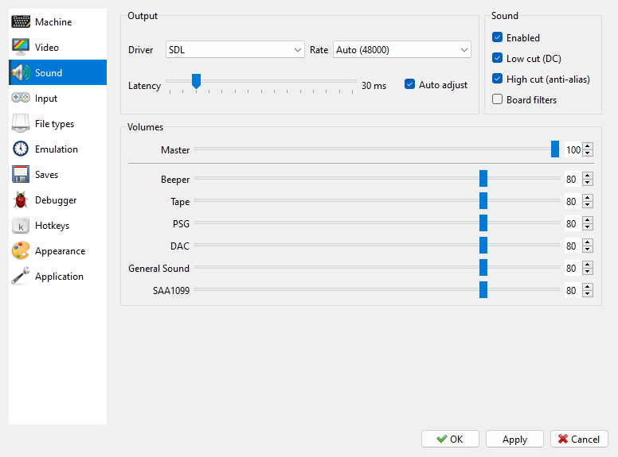

# Sound page

```{index} Sound page
```



```{index} sound
```

What you hear comes from the machine's own sound devices - the beeper, the tape, and
whatever sound chips and cards the machine has. Which devices a machine has is set on
the **Machine** page of **Options** (see [Sound devices](options-machine.md#sound-devices)); how the sound is played and how loud each device is
are on the **Sound** page.

```{index} Driver, Latency, Auto adjust, sound; latency
```

**Options > Sound** has three groups.

**Output** - how the sound reaches your speakers:

- **Driver** - **SDL** plays the sound; **NULL** plays nothing.
- **Rate** - the sample rate: **Auto** uses the rate of your computer's sound device
  and shows that rate; **48000** and **44100** set a fixed rate.
- **Latency** - how much sound is kept ready ahead of playback, from 10 to 150 ms. A
  lower value makes the sound follow the picture and the keys more closely; a value too
  low makes the sound click. With **Auto adjust** ticked (the default) the program finds
  the value by itself: it raises the latency when the sound runs short and lowers it
  again after a long time with no gaps. The slider then shows the value the program has
  settled on.

```{index} Low cut (DC), High cut (anti-alias), anti-alias filter, Board filters
```

The **Sound** group beside **Output** has four switches:

- **Enabled** - with it off, the program plays silence. The machine still runs at its
  normal speed, and its sound is not worked out at all, which leaves more of the
  computer to the emulation. The Debugger's scope and the sound of a rewind are silent
  for that time too.
- **Low cut (DC)** - takes out the lowest frequencies. The chips' output sits above zero
  rather than around it, and that offset only takes loudness away from the rest of the
  sound. On by default.
- **High cut (anti-alias)** - takes out the frequencies too high for the output rate.
  Without it they come back as false notes, which is heard most in beeper music as a
  harsh crunch. On by default; it costs a little CPU time.
- **Board filters** - each machine sounds through what its board put between the sound and
  your ears: a 48K's small speaker, a TV, a filter or a capacitor on the board. Which one is
  set in the **Beeper** row of the **Machine** page, and every machine comes with its own (see
  [Beeper](options-machine.md#beeper)). Off by default: every machine then sounds clean, as
  **Line out**.

```{index} Volumes, Master
```

**Volumes** - one slider for each device, from 0 to 100:

| Volume | What it sets |
|---|---|
| **Master** | everything together; the same as the toolbar's volume |
| **Beeper** | the machine's own speaker |
| **Tape** | the tape, while it plays or records |
| **PSG** | the AY or YM sound chips |
| **DAC** | Covox and Soundrive |
| **General Sound** | the General Sound card |
| **SAA1099** | the SAA1099 chip |

The **Sound** page is the same for every machine.

## Beeper

```{index} beeper, MIC in the beeper
```

The beeper is the machine's own speaker, and every machine has it. Its volume is
**Beeper** on the **Sound** page. **MIC in the beeper**, in the **ULA** group of
**Machine: Advanced Settings**, also mixes the signal the machine sends to the tape into
the beeper sound, a tenth as loud, as a machine with a ULA does (see
[Advanced settings](options-machine.md#advanced-settings)).

## Recording the sound

```{index} Record Sound to WAV, sound; recording
```

**Capture > Record Sound to WAV...** writes what you hear to a file; see
[Capture menu](capture.md).
