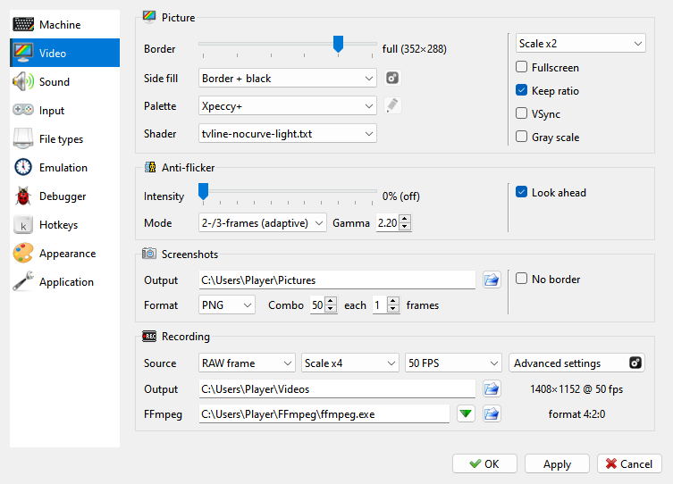
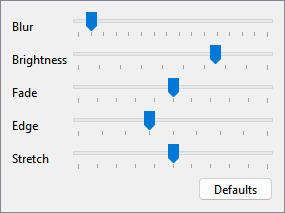

# Video page

```{index} Video page
```



The page has four groups:

- **Picture** - **Border**, **Side fill**, **Palette** with the {icon}`edit` button for
  the **Palette Editor**, **Shader**, and on the right the window scale
  (**Scale x1** to **Scale x6**), **Fullscreen**, **Keep ratio** and **Gray scale**. The
  scale, **Fullscreen**, **Keep ratio**, **Side fill**, the palette and the shader are the
  same settings as in the **View** menu; see [View menu](view.md).
- **Anti-flicker** - see [Anti-flicker](#anti-flicker).
- **Screenshots** - see [Screenshots](#screenshots).
- **Recording** - video recording through FFmpeg. See [Recording](#recording).

## Side fill

```{index} Side fill, Side Fill
```

**Side fill** is what fills the room the picture leaves free in fullscreen or in a
maximized window: **Black**, **Stretched edges** or **Mirror**, the same choice as
**View > Side Fill** (see [Fullscreen](view.md#fullscreen)). The {icon}`settings` button
beside it opens five sliders. The window shows every move at once, **Defaults** puts
every slider back where it starts, and **Cancel** puts back what was there.



- **Blur** - how soft the fill is, from crisp to a wide glow;
- **Brightness** - how bright it is beside the picture;
- **Fade** - how much darker it gets towards the screen's edge;
- **Edge** - how gently the picture runs into the fill;
- **Stretch** - **Mirror** only: the reflection drawn out like pulled rubber - as it is by
  the picture, wider and wider towards the screen's edge, its far part going off the
  screen; at the left end it is a plain one.

The button is grayed out with **Black**, and the whole setting without OpenGL.

## Anti-flicker

```{index} Anti-flicker, Anti-flicker; Intensity, Anti-flicker; Mode, Anti-flicker; Look ahead
```

Some programs show more colors than the machine has by switching between two or three
pictures every frame. On a CRT television this looked like one steady picture; on a
modern screen it flickers. Anti-flicker blends the frames together again. Its settings are
in the **Anti-flicker** group of **Options > Video**:

- **Intensity** - how much of the previous frames is mixed into the picture. **0% (off)**
  turns anti-flicker off; it is off by default.
- **Mode** - which pixels are blended, and how many frames; see the table below.
- **Gamma** - how the colors are mixed. 2.2 is close to a CRT; 1.0 mixes them linearly.
  Values from 1.8 to 2.4 are usual.
- **Look ahead** - only for the adaptive modes: the machine runs two frames ahead in the
  background, so a flicker is recognized sooner after it starts. It costs some extra
  CPU time.

"Fullscreen" in the names of the modes means the whole picture, not fullscreen view:

| Mode | What it does |
|---|---|
| **2-frames (fullscreen)** | Every pixel that changed since the last frame is mixed with its color in that frame, all over the picture. Good for a still two-frame picture; a moving picture gets trails. |
| **2-frames (adaptive)** | Only the pixels that keep alternating between the same two colors for several frames are mixed. Moving parts stay sharp. |
| **3-frames (fullscreen)** | The last three frames are mixed everywhere, for pictures made of three frames in turn (red, green and blue). |
| **2-/3-frames (adaptive)** | Finds both kinds by itself - three-frame pictures and two-frame flicker - and leaves everything else alone. The default. |

The **Anti-flicker** action switches the intensity in turn between 50%, 100% and off,
and the picture shows which one. Its key is set on the **Hotkeys** page of **Options**.

Anti-flicker is not applied in fast mode.

## Screenshots

```{index} Screenshot; format, Screenshot; folder, No border, SCR, Hobeta, PNG
```

The **Screenshots** group on the **Video** page of **Options**:

- **Output** - the folder for the files; the {icon}`fileopen` button beside it picks one.
  Your home folder by default.
- **Format** - the kind of file, see below.
- **Combo** ... **each** ... **frames** - how many pictures **Screenshot Series** takes, and
  how many frames apart.
- **No border** - the screen only, without the border around it.

| Format | What is saved |
|---|---|
| **PNG**, **BMP**, **JPG** | the machine's picture at the window's size, without the shader |
| **SCR** | the 6912 bytes of the machine's screen memory, to load back on a Spectrum |
| **Hobeta** | the same screen memory as a Hobeta file (`.$C`), which goes onto a TR-DOS disk as `screen` |

**SCR** and **Hobeta** hold only the standard Spectrum screen: a picture made in another
video mode does not fit in them.

## Recording

```{index} video; settings, RAW frame, Real FPS
```

The **Recording** group on the **Video** page of **Options**:

- **Source** - **RAW frame** records the machine's picture alone, with no shader and no
  indicators. **Screen** records the window as you see it, shader and all.
- **Scale** - how many times bigger the video is than the machine's picture, from
  **Scale x1** to **Scale x8** (for **RAW frame** only).
- **Real FPS** or **50 FPS** - **Real FPS** records at the machine's own frame rate, which
  on most machines is a little different from 50. **50 FPS** records at exactly 50 frames
  per second, and the sound is adjusted to match.
- **Output** - the folder for the videos; your system's videos folder by default.
- **FFmpeg** - see [Getting FFmpeg](capture.md#getting-ffmpeg).

The size and frame rate of the video are shown beside these settings. The **Border**
setting of the **Picture** group changes the size too.

```{index} Recording: Advanced Settings, video; codec, MP4, MKV, NVENC
```

{icon}`settings` **Advanced settings** opens **Recording: Advanced Settings**:

- **Video** - **Container** (**MP4** or **MKV**), **Codec**, **Preset** (slower makes a
  smaller file, but can slow the machine down), **Quality (CRF)** (lower is better; 18 looks
  lossless), **Color**, and **Blend up to 60 fps**. The codecs are **H.264** and **H.265**,
  **AV1** and the graphics card encoders (**NVENC**, **AMF**, **QSV**) when your FFmpeg and
  computer can use them, and **FFV1, lossless**, which is always saved as MKV.
- **Sound** - **Codec** (**Auto**, **AAC** or **Opus**) and its bit rate. **Keep pitch at
  50 FPS** keeps the notes in tune when **50 FPS** speeds the sound up a little.
- **File name template** - the name of the video file; the name it gives right now is shown
  under it.
- **Auto recording** - see below.
- **FFmpeg** - **Extra options** for the encoder, **Video override** and
  **Sound override** to replace the options Xpeccy+ sets, and the whole FFmpeg command as
  it will run.

```{index} File name template, video; file name
```

The file name template can contain these keys:

| Key | Becomes |
|---|---|
| `%d` | the date, `20260929` |
| `%t` | the time, `153012` |
| `%image` | the name of the file in use (snapshot, tape, disk or divMMC card), or the machine's name when there is none |
| `%machine` | the machine's name |

The default is `xpeccy-plus_%d_%t_%image`. The name is made when the recording stops, so
`%image` is the last file that was in use.

### Auto recording

```{index} Auto recording, Autostart at, Autostop at
```

**Auto recording** starts and stops a video by itself, to catch a demo or a game from its
first frame.

- **Autostart at** - starts a video when the condition is met: **Code in RAM** (the first
  program code the machine runs from RAM, which is where a loaded program starts), or the
  CPU reaching an address: **PC ==**, **PC >=** or **PC <=**, with the address beside it
  (`#8000`, `$8000`, `0x8000` or `32768`). A video is started this way once after each
  reset. When you turn this on in Options, it waits for the next reset.
- **Autostop at** - stops any video, including one started by hand: at a **Reset**, or
  when the CPU reaches an address as above.

**Record Video** used by hand always overrides these settings: after a video is started or
stopped by hand, auto recording does not start one again until the next reset.

The **?** button lists the command-line switches for recording:

- `--video-out <file>` - record from the start into this file; `.mp4` or `.mkv` picks the
  container.
- `--video-auto`, `--no-video-auto` - turn auto recording on or off for this run, with the
  conditions set in Options.
- `--video-autostart <at>`, `--video-autostop <at>` - the conditions for this run: `ram`,
  `reset`, or an address such as `==#6000` or `">=#8000"`.

They hold for that run only. See [Command line](command-line.md).
