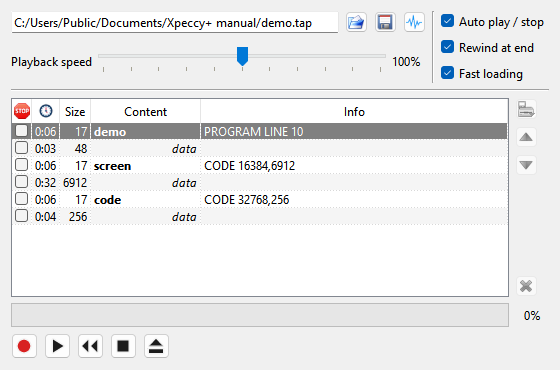

# Tapes

```{index} tape, TAP, TZX
```

The machine has a tape recorder: it plays a tape image into the machine's EAR input, and
records what the machine saves. Xpeccy+ reads `.tap`, `.tzx` and `.wav` tapes and
saves `.tap` and `.wav`.

## Putting a tape in

```{index} tape; opening
```

Open a tape like any other file: **File > Open...**, a drop onto the window, **Recent** or
**Favorites**. Run resets the machine and loads the tape; Mount only puts it in (see
[Run a program](getting-started.md#run-a-program)).

The **Tape Player** has its own {icon}`fileopen` open button. A tape opened there is only
mounted, and Xpeccy+ never switches to another machine for it.

## The Tape Player

```{index} Tape Player, Playback speed
```



**Media > Tape Player** opens the player, as do the {icon}`tape` toolbar button and a click
on the tape in the status bar. The hotkey is F6 (Modern).

At the top:

- the name of the tape file;
- {icon}`fileopen` **Open a tape image** - puts a tape in, mounted;
- {icon}`save_all` **Save the tape to a file** - see [Saving a tape](#saving-a-tape);
- {icon}`wav` **Export the tape as a WAV recording** - see [Export to WAV](#export-to-wav);
- **Playback speed** - how fast the tape plays, from 95% to 105% of normal. A few tapes
  made on machines with an unusual clock load only when the speed is moved a step up or
  down.

At the right, three switches, described below: **Auto play / stop**, **Rewind at end** and
**Fast loading**.

In the middle is the list of the blocks on the tape, with buttons beside it. Under the list
a bar shows how far the tape is into the current block.

At the bottom are the buttons of the deck: {icon}`tape-rec` **Record**,
{icon}`tape-play` **Play**, {icon}`tape-rewind` **Rewind to the start**,
{icon}`tape-stop` **Stop** and {icon}`tape-eject` **Eject the tape**. A tape cannot be
ejected or rewound while it plays.

The window title says **Tape Player - modified** when blocks were recorded, moved or
deleted since the tape was opened or saved.

## The block list

```{index} tape; blocks, tape; stop at a block
```

Each row is one block of the tape:

| Column | What it shows |
|---|---|
| {icon}`stop` | a box to stop the tape at this block |
| {icon}`clock` | how long the block plays |
| **Size** | bytes in the block |
| **Content** | the name in the header, in bold, or the kind of block in italics: *program*, *code*, *number array*, *character array*, *header*, *data*, or *custom* for a signal that is not bytes |
| **Info** | what the header says, such as `PROGRAM LINE 10` or `CODE 32768,6912`, or the text a TZX gives the block |

The block the tape is at is marked, and the list keeps it in view as the tape plays.

Double-click a block to wind the tape to its start.

Tick the box in the first column to stop the tape when it reaches that block. Some tapes
mark such stops themselves; the **Info** column then says **stop the tape**, or
**stop the tape on a 48K**.

The buttons beside the list work on the selected block:

- {icon}`floppy` **Copy the block to a disk as a TR-DOS file** - opens a menu of the
  drives, see [Copying a block to a disk](#copying-a-block-to-a-disk);
- {icon}`arrow-up` **Move the block up**, {icon}`arrow-down` **Move the block down**;
- {icon}`cancel` **Delete the block**.

## Playing

```{index} tape; playing, Auto play / stop, Rewind at end, Tape Rewind to Start
```

{icon}`tape-play` **Play** starts the tape, {icon}`tape-stop` **Stop** stops it. The same
commands are **Media > Tape Play/Stop** and the status bar's right-click menu.

**Auto play / stop** lets the machine start and stop the tape. The tape starts when a
program reads the tape the way a loader does, and stops when the loader stops reading,
between blocks and at the end. A program that only reads the keyboard never starts it. A
game that has loaded and waits for a key stops the tape too, even when the tape still has a
long pause to play.

When a program loads through the ROM's loading routine and the next block cannot be the one
it asks for, the tape winds on to the block that is, as you would wind a deck on to side B.
This needs **Auto play / stop** or **Flash loading** on.

When you press **Stop**, it overrides **Auto play / stop**: the tape stays stopped until
you press **Play**, rewind it, or put another tape in.

**Rewind at end**: a tape that has played to its end goes back when it is needed again:

- on the next **Play**, to the beginning;
- when a program loads through the ROM's loading routine, to the first block that fits
  what it loads - a multi-load game that asks for side B gets side B's block.

A program's own loader does not wind the tape back: what it asks for may be on the other
side.

With this switch off, the tape stays at its end until you rewind it. It is on by default.

The **Tape Rewind to Start** hotkey winds the tape back without opening the window:
Shift+F4 (Modern).

## Fast loading

```{index} Fast loading, tape; fast loading, Flash loading, Edge detection
```

**Fast loading** runs the machine at full speed while a loader reads the tape. The sound
is off, and the picture is updated only as many times a second as **Fast Mode render**
sets (see [Fast Mode](time.md#fast-mode)). When the loading is
over, the machine goes back to the moment the loader finished, so the program starts at
normal speed.

Two more settings refine it. They are on the **Machine: Tape** sheet of **Options** (see
[Machine: Tape](options-machine.md#machine-tape)), and work only with **Fast loading** on:

- **Flash loading** - blocks read by the ROM's loading routine, or by a copy of it inside
  a program, go straight into memory without the tape playing. A SAVE through the ROM
  goes straight onto the tape the same way.
- **Edge detection** - a loader waiting for the next pulse gets it at once. Faster, but
  not exact: the rest of the machine does not move on while the loader waits.

Fast loading itself does not change how the loader runs, so a tape that loads at normal
speed loads this way too, turbo loaders included. Edge detection is not exact: if a tape
fails to load with it, switch **Edge detection** off.

## Recording

```{index} tape; recording
```

{icon}`tape-rec` **Record** starts recording: what the machine saves goes onto the tape
as new blocks, after the last one. {icon}`tape-stop` **Stop** ends the recording.
**Media > Tape Record/Stop** does the same. Both work when no tape is in: the recording
makes a new tape.

With **Fast loading** and **Flash loading** on, a SAVE through the ROM needs no recording:
its blocks go onto the tape at once.

## Saving a tape

```{index} tape; saving
```

{icon}`save_all` **Save the tape to a file** in the **Tape Player** writes the tape over
its own file. For a tape that has no file yet, such as one just recorded, you are asked for
a file name.

Xpeccy+ does not write TZX, and a `.wav` is a recording rather than a tape file. So for a
tape opened from a `.tzx` or a `.wav` you are asked for a new name instead, to save the
tape as `.tap`. Only a tape of standard blocks can become a `.tap`; export any other tape
as a WAV recording (see below).

As with a disk, you are asked about a changed tape before it is ejected or another tape is
opened, and when the program closes: **Tape: game.tap has been changed. Do you
want to save it?**

## WAV files

```{index} WAV, tape; WAV files
```

A `.wav` file opens as a tape. Standard blocks in it are decoded into bytes, so they show
in the block list with their names and can be flash loaded. Anything else stays as the
recorded signal and plays as it is. The file can be 8, 16, 24 or 32 bit, or 32-bit float, with
up to 8 channels, at 4000 to 192000 Hz.

### Export to WAV

```{index} Export Tape to WAV, WAV; export
```

{icon}`wav` **Export the tape as a WAV recording** opens **Export Tape to WAV**:

- **Sample rate** - **Auto** picks a rate to fit the shortest pulse on the tape, and shows
  that rate; or 44100, 48000, 96000 or 192000 Hz.
- **Sample size** - **16 bit**, or **8 bit** for half the file size.
- **Level** - the recording level, in percent of full scale.
- **Lead-in** - silence before the first block, in ms.
- **Tail** - silence after the last block, in ms.

The line below shows the number of blocks, the playing time and about how big the file
will be. **OK** asks for the file name. The settings are kept, and **WAV recording,
export** in **File > Save...** uses them too.

## Copying a block to a disk

```{index} tape; copying to a disk
```

{icon}`floppy` **Copy the block to a disk as a TR-DOS file** opens a menu of drives,
**Drive A** to **Drive D**. The selected block goes to that drive's disk as a TR-DOS file:

- a header and the data block after it become a program (`B`) or code (`C`) file named as
  in the header;
- a data block with a header before it is copied the same way;
- a data block with no header becomes a code file called `FILE`.

Only standard blocks can be copied. A drive with no disk gets a new, formatted one; a disk
that is not a TR-DOS disk is formatted after you agree. Files go the other way, from a disk
to the tape, in the **Disk Manager** (see [Disk Manager](disks.md#disk-manager)).

## The tape in the status bar

```{index} tape; indicator
```

The status bar shows the tape's {icon}`tapeGreen` light, the block being played and how far
the tape is through it, with the commands of the deck on a right-click: see
[Status bar](main-window.md#status-bar). The light stays with no tape in, dimmed, and a
click on it opens the **Tape Player**.

With the status bar hidden, a light over the picture blinks while the tape plays (green) or
records (red). **Tape** in the **Indicators** group of the **Appearance** page of
**Options** turns this light on and off.
