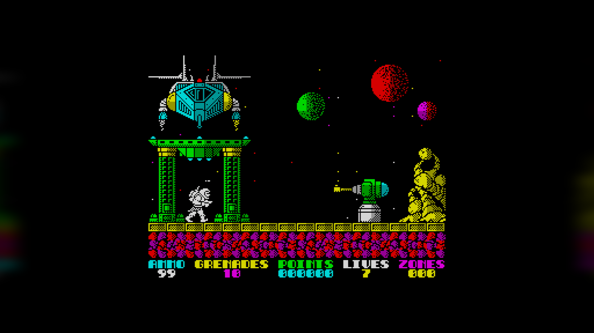
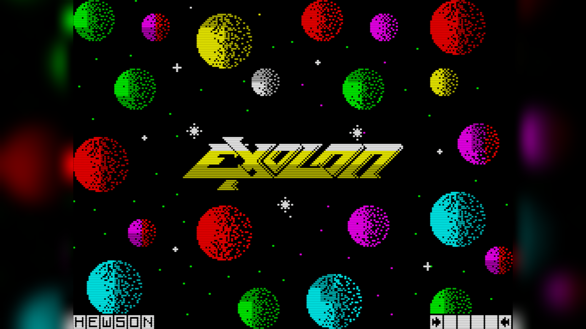
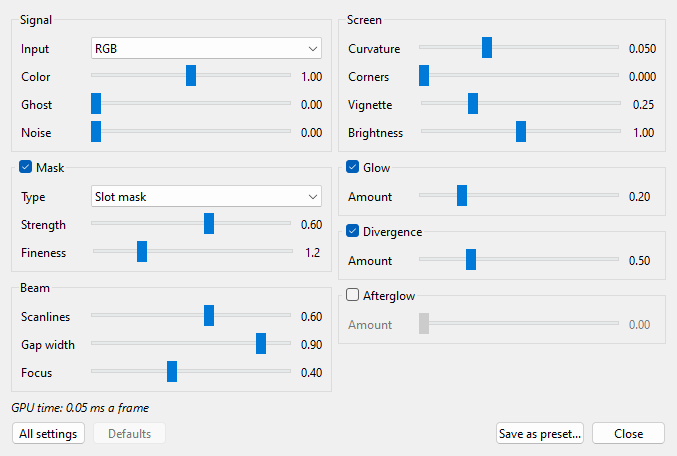
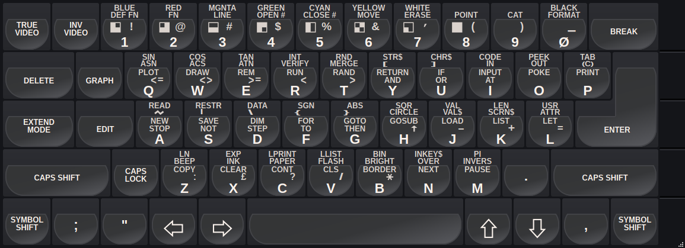
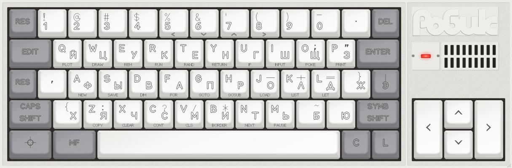

# View menu

```{index} View menu
```

How big the picture is, how much border it shows, and how it is drawn: the colors, a
shader, anti-flicker. The quick switches are in the **View** menu; all the settings are on
the **Video** page of **Options** (see [Video page](options-video.md)). The menu also keeps
the window over the others, hides a still pointer, and shows and hides the menu bar, the
toolbar, the status bar, the virtual keyboard and the input overlay.

## Size

```{index} window size, scale
```

**View > Size** has **x1** to **x6**: each pixel of the machine is drawn as a square of
1 x 1 to 6 x 6 screen pixels. The scale is always a whole number, so every pixel of the
picture is the same size and nothing is blurred. At **x1** the picture is drawn
as it is, without a shader.

The window's size follows from the scale and the border size, and changes when either
of them changes.

```{index} window; maximize, maximize
```

The window can also be maximized, or resized by dragging its edges or snapping it to
half of the screen. At any size other than its scale's, the picture is fitted to the
window as in fullscreen: as big as fits, with more border in the room it leaves, up to
the full border, and black or a side fill past that (see [Fullscreen](#fullscreen)). A
size picked in **View > Size** brings back the scale's size with its whole
pixels; a maximized window restored gets the size it had before. On macOS the green
button is fullscreen; Option-click on it maximizes the window.

The window's size is remembered: if the program is closed maximized, it starts maximized
next time, on the same screen; closed at a size of its own, it starts at that size.

## Border

```{index} Border slider, border; size, overscan
```

The **Border** slider in the **Picture** group of **Options > Video** sets how much
border is shown around the screen. The label beside it names the size and gives it in
machine pixels:

| Size | Picture |
|---|---|
| **no** | 256 x 192, the screen alone |
| **tiny** | 272 x 208 |
| **small** | 288 x 224 |
| **medium** | 320 x 240 |
| **full** | 352 x 288 |
| **overscan** | the whole frame the machine draws |

**View > Border** has the same sizes, taken at once, with the machine running or paused.

The setting is the same for every machine, but some machines need more of their frame
than others: ATM Turbo 2+ and ZX Evolution (BaseConf) show at least **medium**, the ZX
Spectrum Next at least **full**, and ZX Evolution (TSConf) always shows its whole frame -
the slider and **View > Border** are grayed out there. On the others, **View > Border**
grays out the sizes smaller than the machine shows.

## Fullscreen

```{index} Fullscreen, Keep Aspect Ratio, aspect ratio, Integer Scale, Fit
```

**View > Fullscreen** fills the whole screen with the picture. In fullscreen the
picture is fitted to the screen rather than kept to whole pixels, unless
**View > Integer Scale** is ticked. How to reach the menu from there is in
[Fullscreen](main-window.md#fullscreen).

**View > Keep Aspect Ratio** matters in fullscreen and in a window that is maximized or
resized:

- ticked - the picture keeps its shape, and the room it leaves - at the sides of a wide
  screen, above and below it in a tall window - is filled as **View > Side Fill** says;
- not ticked - the picture is stretched to fill the whole screen or window.

**View > Integer Scale**, under it, keeps that picture to whole pixels: every dot is the
same number of screen pixels, as many as fit with the border the **Border** size sets.
The room left around the picture is filled as **View > Side Fill** says. It is off by
default, and grayed out while **Keep Aspect Ratio** is not ticked.

**Fit** on the Video page of **Options** holds both: **Stretch**, **Keep ratio** or
**Integer scale**.

```{index} Side Fill
```

**View > Side Fill** sets what fills the room the picture leaves free. The first four
show more border there first, up to the **full** border (with **overscan** chosen, as far
as the machine's frame goes), so a border that flashes is seen big; the fill takes the
room past it:

- **Border + Black** - black past the border, the default;
- **Border + Stretched Edges**, **Border + Mirror**, **Border + Letterbox** - the fill past
  the border, as below.

The other four keep the border at the size the **Border** slider sets, and the fill
starts at its edge; with **no** border, at the edge of the screen itself:

- **Black** - black bars;
- **Stretched Edges** - the picture's outer rows and columns carried outwards, blurred and
  dimmed, like a glow; with **Blur** at **Off**, sharp - each row of dots runs on as it is,
  the shader's scanlines with it, so a loading border fills the whole screen;
- **Mirror** - the picture as it is shown, through the shader and with a curved screen's
  black corners too, reflected at its edge, blurred and dimmed;
- **Letterbox** - the screen itself, without the border, blown up to cover the whole room,
  blurred and dimmed; by the picture its edges are carried out as with **Stretched Edges**
  and run into it, so the picture has no hard edge. It looks best with no border and a
  picture that reaches its edges.

While the window is resized, the border grows with it smoothly, its edge cut at the
window's edge rather than a whole dot at a time.





It is the same setting as **Side fill** on the **Video** page of **Options**, where its
blur and brightness are set too (see [Side fill](options-video.md#side-fill)). Without
OpenGL only **Border + Black** and **Black** can be picked.

Fullscreen is remembered: if the program is closed in fullscreen, it starts in
fullscreen next time.

## Always on Top

```{index} Always on Top
```

**View > Always on Top** keeps the main window over the windows of other programs, even
when another program is in use. The program's own windows - the **Debugger**, the **Tape
Player**, **Options**, a message - still open over it. It is off in fullscreen and comes
back when the window does. The switch is remembered; it is also **Always on top** on the
[Appearance page](options-appearance.md) of **Options**.

## Auto-Hide Pointer

```{index} Auto-Hide Pointer, pointer; hiding, mouse; pointer
```

**View > Auto-Hide Pointer** hides the mouse pointer once it stays still over the picture
for 2 seconds, in a window and in fullscreen. A move brings it back; over the bars, a menu
or a dialog it stays. It is on by default, and the switch is remembered; it is also
**Auto-hide pointer** on the [Appearance page](options-appearance.md) of **Options**.

## Display

```{index} Display, shader, look
```

```{index} see: scan lines; Display
```

A look changes the picture after it is drawn: scan lines, the mask of a CRT tube, a curved
screen, the blur of a TV signal. Pick one in **View > Display**, or in the **Display** list
of **Options > Video**, where it shows at once and **Cancel** puts back the one that was
there. The list has four parts:

- **None** - the picture as it is - and **Scanlines**: plain scan lines with a hard or a
  soft dot, even at any window size and about as bright as **None**;
- the looks of a tube with its mask: **Aperture grille**, **Fine grille**, **Shadow mask**
  and **Wide shadow mask**, each also as **soft**, with softer lines and dots;
- the presets you saved;
- the other shaders, each a file: **tvline-nocurve-light**, the one a new installation
  starts with, and the rest.

```{index} Display; settings, knobs, preset
```

A look with settings has a window of them: **View > Display > Settings...**, or the
{icon}`settings` button beside the list in **Options**. **Scanlines** has **Depth** - how
dark the gap between two lines is - and **Softness**; a tube's look has its lines, mask,
bloom, curvature and brightness. The picture shows every move at once, and what you set
stays with the look: pick another and come back, and it is as you left it.



- **All settings** - shows the finer ones too;
- **Defaults** - puts every setting of this look back;
- **Save as preset...** - saves the look as it stands under a name of yours; it joins
  the list;
- **Delete preset** - removes a preset of yours.

What you changed in the looks goes into the file of **Export settings...**, and
**Reset to defaults** puts every look back as it comes
(see [Application page](options-application.md)); your presets stay.

A look is not used at **x1**, where there is no room for its effect. With **None**,
a picture that is not a whole number of screen pixels per dot - in fullscreen, in a
maximized window - has only the seams between dots softened, so every dot keeps the same
width and the picture stays sharp. When the
computer's graphics cannot run shaders, the list holds **None** only. With no usable OpenGL at
all, on an old graphics chip, the picture is drawn without it, and the window says so at
the start; `--no-gl` does the same on purpose.

```{index} shader; own, GLSL
```

Your own shaders go in the `shaders` folder of the settings folder, as `.txt` files; your
presets are kept there too, as `.preset` files.
A file there with the name of a built-in shader replaces that shader. The file holds two
parts in GLSL: a line `vertex:` followed by the vertex shader, and a line `fragment:` followed by
the fragment shader. The picture comes in as the texture `rubyTexture`, with its size in
`rubyInputSize` and `rubyTextureSize`; the size of the picture on the screen is in
`rubyOutputSize`. A file can also hold several passes, each drawn into a picture of its own
that the next one reads, with textures and with parameters, which are the settings of its
window; `config/shaders/README.md` describes the format.

If the shader does not work, the message on the picture is **shader error** and the picture
is shown without a shader. The button **Error: check the log** then stands beside the
**Display** list of **Options > Video**: its tip has the first error with the file's line, a
click on it opens all of them. The shader stays chosen: correct the file and read it again.

```{index} Reload Shader
```

The **Reload Shader** action reads the shader file again, so you can see a change you
have just saved, and says **shader reloaded**. It has no key by default; give it one on the **Hotkeys** page of
**Options** (see [Hotkeys page](hotkeys.md)).

## ZX Palette

```{index} palette, ZX Palette, Palette Editor
```

```{index} see: color; palette
```

The 16 colors of the ZX picture can be taken from several palettes. Pick one in
**View > ZX Palette**, or in the **Palette** list of **Options > Video**. **Xpeccy+** is
the built-in palette; the others are listed by their file names, without the extension.

To change the colors of a palette, pick it in **Options > Video** and click the
{icon}`edit` edit button beside the list. The **Palette Editor** shows the 16 colors in four
rows: the eight normal colors in the top two rows, the eight bright ones below them. Click a
color to choose another one, then click **OK**. The change takes effect only after
**Apply** or {icon}`ok-apply` **OK** in **Options**; {icon}`cancel` **Cancel** there
discards it. The
edited palette is saved under the same name in the `palettes` folder of the settings folder
(see [Where the settings are](getting-started.md#where-the-settings-are)), and from then on
that file is used instead of the bundled one. The built-in **Xpeccy+** palette cannot
be edited: the edit button is grayed out for it.

When a bundled palette has been edited, a second button, {icon}`refresh`, appears beside the
edit button. After asking, it deletes your edited copy, and the palette is again the one
that came with the program.

```{index} palette; own
```

A palette of your own is a text file in the same `palettes` folder: 16 lines, one color
on each, written as `#RRGGBB` - black, blue, red, magenta, green, cyan, yellow, white,
then the same eight colors bright. A file with fewer than 16 colors is not used; the
built-in palette is shown instead.

```{index} Grayscale
```

**Grayscale** in the **Picture** group of **Options > Video** draws the picture in shades of gray.

A palette or **Grayscale** changed while the machine is paused shows at once, unless a tape
is playing: the picture is drawn again in the new colors, and the machine stays where it
was.

```{index} ULA+, ULA plus
```

A machine with ULA+ can show 64 colors when a program asks for them. ULA+ is switched on
with **ULA plus** in the machine's advanced settings (see
[Advanced settings](options-machine.md#advanced-settings)).

## Menu Bar, Toolbar and Status Bar

```{index} Menu Bar; hiding, Toolbar; showing, Status Bar; showing
```

**View > Menu Bar**, **View > Toolbar** and **View > Status Bar** show and hide the
[menu bar](menu-bar.md), the [toolbar](toolbar.md) and the
[status bar](main-window.md#status-bar). The window shrinks by the bar's height, and the
picture keeps its size. The same switches are on the
[Appearance page](options-appearance.md) of **Options**.

The menu bar hidden takes the toolbar with it, as in fullscreen, and both are still at
hand. Hold the pointer at the top edge of the window: a thin see-through strip in the
menu bar's color shows at once that the pointer is in the right place, and a moment
later the menu bar comes down over the picture, with the toolbar under it. Both go away
a moment after the pointer leaves them. A right-click on the picture has **Show Menu Bar** at the end of its menu. The
**Menu Bar** hotkey can be set on the **Hotkeys** page of **Options**; it has no key by
default.

On macOS the menu is in the system menu bar, and **View > Menu Bar** is not there.

With the status bar hidden, its lights can be shown over the picture instead: see
[Indicators on the picture](options-appearance.md#indicators-on-the-picture).

## Virtual Keyboard

```{index} Virtual Keyboard, Dock under the emulator
```


**View > Virtual Keyboard > Show** (Alt+K) opens a picture of the Spectrum keyboard. The keys that are
pressed on the machine light up, whether they come from the PC keyboard, a joystick on keys
or a click here.

- Left button on a key - holds the key down while the button is held. On Caps Shift and
  Symbol Shift it locks the key down instead, and a second click releases it: click Caps
  Shift, then a digit, to get a cursor key.
- Right button on a key - locks the key down; a second right click releases it.
- Middle button on a key - releases all the keys.

A key takes clicks on itself and on the words over and under it. Right-click between the
rows or beside the keys for its settings; they are also under **Show** in **View > Virtual
Keyboard** and in the **Virtual Keyboard** submenu of the picture's right-click menu, which
is easier with the 128K's close-set keys:

- **Zoom x1**, **Zoom x1.5**, **Zoom x2**, **Zoom x3** - the size of the window. You can
  also drag its edge; the picture keeps its shape and is drawn sharp at any size.
- **Skin** - **48K (Classic)**, **48K (White)**, **128K (Classic)**, **128K (White)**,
  **Next (Black)**, **Next (White)**, **Next (Magenta)**, **Klava**, **Klava (Washed)**,
  **Robik** or **Robik (Full-Size)**; one picked here stays whatever the machine.
  Klava is the 58-key keyboard of many clones of the early 1990s, worn, with some caps
  crooked and the cream ones yellowed; Klava (Washed) is it clean. Robik, below,
  is the keyboard of the Robik with a narrow rim of its case round the keys; Robik
  (Full-Size) is it in its whole case, the keys smaller in the window. **By machine**, on by default, shows
  the Next keyboard on the ZX Spectrum Next, the 128K one on a 128K, +2, +2A or +3, the 48K
  one on a 48K, Robik on the Robik and Klava on the other clones (Pentagon,
  Scorpion, Profi, ATM, ZX Evolution and the rest), in the tone
  picked last: Klava (Washed) if it was picked; only the Next has a Magenta one, the others
  show their classic one. The window's title names the skin it shows.
- **Dock under the emulator** - the keyboard loses its frame and sits under the main window,
  as wide as the main window, and moves with it. In fullscreen, or when there is no room
  below, it lies over the bottom of the picture.
- **Highlight the key under the pointer** - the key the mouse is over lights up as a
  pressed one does, but dimly, so you can see which key a click will take. On by default.
- **Release all keys** - releases every key.

Keys typed while the window is in front go to the machine. Esc closes the window. Not
docked, it opens again where it was left.



On the 128 keyboard the extra keys (True Video, Edit, Delete, the cursor keys and the
rest) press Caps Shift or Symbol Shift together with a key, as on the real one; a right
click locks such a key whole.

Such a key lights up while it is held here, or while the PC key that makes it is held -
Backspace for Delete, the arrows for the cursor keys, and so on. The two keys it presses
light up dimly. Pressed one by one, they light up fully and the extra key stays dark. On the
48K keyboard, which has no such keys, the two keys light up fully. Of the two Caps Shifts
and the two Symbol Shifts only one lights up: the one you clicked, otherwise the one on the
side of the PC key that holds it (the right Shift lights the right one), otherwise the left
one.



The Robik keyboard has keys the Spectrum has not:

- The cursor block on the right and the key with the crosshair are the Kempston joystick:
  up, down, left, right and fire. They light up while the joystick is pressed, from a
  gamepad too.
- The two RES keys reset the machine together, as on the real one: a click on one does
  nothing but hold it. Right-click one RES to lock it down, then click the other.
- On the Robik, Edit, Del, the full stop, the comma, Х, Ж, Э, Б, Ю, C and L are its own
  keys. On other machines Edit and Del are Caps Shift with 1 and with 0, the full stop and
  the comma Symbol Shift with M and with N, and the rest do nothing.
- MF does nothing: on the Robik it is wired to nothing.
- The red light under the logo is the power light: always on.

For layout authors: a file `zx-black.json`, `zx-white.json`, `zx-128.json`,
`zx-128-white.json`, `zx-next.json`, `zx-next-white.json`, `zx-next-magenta.json`,
`zx-kopir.json`, `zx-kopir-worn.json`, `zx-robik.json` or `zx-robik-compact.json` in the
`vkbd` folder of the settings folder (see
[Where the settings are](getting-started.md#where-the-settings-are)) is drawn instead of the
built-in skin of that name, and drawn again each time the file is saved. A file of any
other name there, `zx-<name>.json`, is a skin of its own: it is in the **Skin** menu under
that name, after the built-in ones.

## Input Overlay

```{index} Input Overlay
```

**View > Input Overlay** draws the keys, the joystick and the mouse over the picture, lit
while they are pressed. It is marked **EXPERIMENTAL** in the menu.

- **Show** - the overlay on or off.
- **Keyboard**, **Joystick**, **Mouse** - which parts to draw: the 40 Spectrum keys, the
  Kempston joystick with its fire buttons, the Kempston mouse with its buttons and wheel. A
  joystick or mouse the machine does not have is drawn faint.
- **Source** - where the overlay takes the input from:
  **Auto: replay reads, host otherwise** - what the program read while an RZX replay plays,
  and what you press the rest of the time; **What the program reads** - only the keys and
  buttons a program has read; **What is pressed on the host** - everything you press, read or
  not.
- **Position** - **Bottom left**, **Bottom**, **Bottom right** (the default), **Top left**,
  **Top** or **Top right**.
- **Size** - **Small**, **Medium** or **Large**.
- **Opacity** - from **40%** to **100%**.
