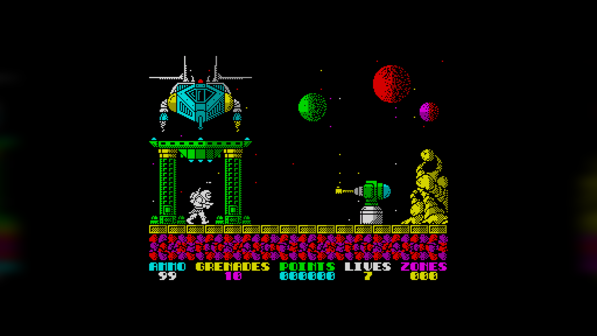

# View menu

```{index} View menu
```

How big the picture is, how much border it shows, and how it is drawn: the colors, a
shader, anti-flicker. The quick switches are in the **View** menu; all the settings are on
the **Video** page of **Options** (see [Video page](options-video.md)). The menu also shows
and hides the toolbar, the status bar, the virtual keyboard and the input overlay.

## Size

```{index} window size, scale
```

**View > Size** has **x1** to **x6**: each pixel of the machine is drawn as a square of
1 x 1 to 6 x 6 screen pixels. The scale is always a whole number, so every pixel of the
picture is the same size and nothing is blurred. At **x1** the picture is drawn
as it is, without a shader.

The window's size follows from the scale and the border size, and changes when either
of them changes.

```{index} window; maximize, maximize
```

The window can also be maximized, or resized by dragging its edges or snapping it to
half of the screen. At any size other than its scale's, the picture is fitted to the
window as in fullscreen: as big as fits, with black bars where it does not fill (or a
side fill, see [Fullscreen](#fullscreen)), and more border at the sides up to the full
border. A size picked in **View > Size** brings back the scale's size with its whole
pixels; a maximized window restored gets the size it had before. On macOS the green
button is fullscreen; Option-click on it maximizes the window.

The window's size is remembered: if the program is closed maximized, it starts maximized
next time, on the same screen; closed at a size of its own, it starts at that size.

## Border

```{index} Border slider, border; size, overscan
```

The **Border** slider in the **Picture** group of **Options > Video** sets how much
border is shown around the screen. The label beside it names the size and gives it in
machine pixels:

| Size | Picture |
|---|---|
| **no** | 256 x 192, the screen alone |
| **tiny** | 272 x 208 |
| **small** | 288 x 224 |
| **medium** | 320 x 240 |
| **full** | 352 x 288 |
| **overscan** | the whole frame the machine draws |

**View > Border** has the same sizes, taken at once, with the machine running or paused.

The setting is the same for every machine, but some machines need more of their frame
than others: ATM Turbo 2+ and ZX Evolution (BaseConf) show at least **medium**, the ZX
Spectrum Next at least **full**, and ZX Evolution (TSConf) always shows its whole frame -
the slider and **View > Border** are grayed out there. On the others, **View > Border**
grays out the sizes smaller than the machine shows.

## Fullscreen

```{index} Fullscreen, Keep Aspect Ratio, aspect ratio
```

**View > Fullscreen** fills the whole screen with the picture. In fullscreen the
picture is fitted to the screen rather than kept to whole pixels. How to reach the menu
from there is in [Fullscreen](main-window.md#fullscreen).

**View > Keep Aspect Ratio** matters in fullscreen and in a window that is maximized or
resized:

- ticked - the picture keeps its shape. On a screen or window wider than the picture,
  more border is shown at the sides instead of black bars, up to the **full** border
  (with **overscan** chosen, as far as the machine's frame goes);
- not ticked - the picture is stretched to fill the whole screen or window.

```{index} Side Fill
```

**View > Side Fill** sets what fills the room the picture leaves free: at the sides of a
wide screen once the machine's frame runs out, above and below it in a tall window.

- **Black** - nothing, the default;
- **Stretched Edges** - the picture's outer rows and columns carried outwards, blurred and
  dimmed, like a glow of the border;
- **Mirror** - the picture as it is shown, through the shader and with a curved screen's
  black corners too, reflected at its edge, blurred and dimmed.



It is the same setting as **Side fill** on the **Video** page of **Options**, where its
blur and brightness are set too (see [Side fill](options-video.md#side-fill)). Without
OpenGL the menu is grayed out and the room stays black.

Fullscreen is remembered: if the program is closed in fullscreen, it starts in
fullscreen next time.

## Shaders

```{index} shader
```

```{index} see: scan lines; shader
```

A shader changes the look of the picture after it is drawn: scan lines, the mask of a
CRT tube, a curved screen, the blur of a TV signal. Pick one in **View > Shaders**, or in
the **Shader** list of **Options > Video**; **None** turns it off. The program comes with
twenty shaders built in, and one of them is on by default.

The shader is not used at **x1**, where there is no room for its effect. With **None**,
a picture that is not a whole number of screen pixels per dot - in fullscreen, in a
maximized window - has only the seams between dots softened, so every dot keeps the same
width and the picture stays sharp. When the
computer's graphics cannot run shaders, the list holds **None** only. With no usable OpenGL at
all, on an old graphics chip, the picture is drawn without it, and the window says so at
the start; `--no-gl` does the same on purpose.

```{index} shader; own, GLSL
```

Your own shaders go in the `shaders` folder of the settings folder, as `.txt` files.
A file there with the name of a built-in shader replaces that shader. The file holds two
parts in GLSL: a line `vertex:` followed by the vertex shader, and a line `fragment:` followed by
the fragment shader. The picture comes in as the texture `rubyTexture`, with its size in
`rubyInputSize` and `rubyTextureSize`; the size of the picture on the screen is in
`rubyOutputSize`. When a shader is picked, the message **shader compiled** appears on the
picture. If the shader does not work, the message is **shader error**, and the picture is
shown without a shader.

```{index} Reload Shader
```

The **Reload Shader** action reads the shader file again, so you can see a change you
have just saved. It has no key by default; give it one on the **Hotkeys** page of
**Options** (see [Hotkeys page](hotkeys.md)).

## ZX Palette

```{index} palette, ZX Palette, Palette Editor
```

```{index} see: color; palette
```

The 16 colors of the ZX picture can be taken from several palettes. Pick one in
**View > ZX Palette**, or in the **Palette** list of **Options > Video**. **Xpeccy+** is
the built-in palette; the others are listed by their file names, without the extension.

To change the colors of a palette, pick it in **Options > Video** and click the
{icon}`edit` edit button beside the list. The **Palette Editor** shows the 16 colors in four
rows: the eight normal colors in the top two rows, the eight bright ones below them. Click a
color to choose another one, then click **OK**. The change takes effect only after
**Apply** or {icon}`ok-apply` **OK** in **Options**; {icon}`cancel` **Cancel** there
discards it. The
edited palette is saved under the same name in the `palettes` folder of the settings folder
(see [Where the settings are](getting-started.md#where-the-settings-are)), and from then on
that file is used instead of the bundled one. The built-in **Xpeccy+** palette cannot
be edited: the edit button is grayed out for it.

When a bundled palette has been edited, a second button, {icon}`refresh`, appears beside the
edit button. After asking, it deletes your edited copy, and the palette is again the one
that came with the program.

```{index} palette; own
```

A palette of your own is a text file in the same `palettes` folder: 16 lines, one color
on each, written as `#RRGGBB` - black, blue, red, magenta, green, cyan, yellow, white,
then the same eight colors bright. A file with fewer than 16 colors is not used; the
built-in palette is shown instead.

```{index} Gray scale
```

**Gray scale** in the **Picture** group of **Options > Video** draws the picture in shades of gray.

```{index} ULA+, ULA plus
```

A machine with ULA+ can show 64 colors when a program asks for them. ULA+ is switched on
with **ULA plus** in the machine's advanced settings (see
[Advanced settings](options-machine.md#advanced-settings)).

## Toolbar and Status Bar

```{index} Toolbar; showing, Status Bar; showing
```

**View > Toolbar** and **View > Status Bar** show and hide the [toolbar](toolbar.md) and the
[status bar](main-window.md#status-bar). With the status bar hidden, its lights can be shown
over the picture instead: see [Indicators on the picture](options-appearance.md#indicators-on-the-picture).

## Virtual Keyboard

```{index} Virtual Keyboard, Dock under the emulator
```


**View > Virtual Keyboard > Show** (Alt+K) opens a picture of the Spectrum keyboard. The keys that are
pressed on the machine light up, whether they come from the PC keyboard, a joystick on keys
or a click here.

- Left button on a key - holds the key down while the button is held. On Caps Shift and
  Symbol Shift it locks the key down instead, and a second click releases it: click Caps
  Shift, then a digit, to get a cursor key.
- Right button on a key - locks the key down; a second right click releases it.
- Middle button on a key - releases all the keys.

A key takes clicks on itself and on the words over and under it. Right-click between the
rows or beside the keys for its settings; they are also under **Show** in **View > Virtual
Keyboard** and in the **Virtual Keyboard** submenu of the picture's right-click menu, which
is easier with the 128K's close-set keys:

- **Zoom x1**, **Zoom x1.5**, **Zoom x2**, **Zoom x3** - the size of the window. You can
  also drag its edge; the picture keeps its shape and is drawn sharp at any size.
- **Skin** - **48K (Classic)**, **48K (White)**, **128K (Classic)**, **128K (White)**,
  **Next (Black)**, **Next (White)** or **Next (Magenta)**; one picked here stays whatever
  the machine. **By machine**, on by default, shows the Next keyboard on the ZX Spectrum
  Next, the 128K one on a 128K, +2, +2A or +3 and the 48K one on every other machine, in
  the tone picked last; only the Next has a Magenta one, the others show their classic one.
- **Dock under the emulator** - the keyboard loses its frame and sits under the main window,
  as wide as the main window, and moves with it. In fullscreen, or when there is no room
  below, it lies over the bottom of the picture.
- **Highlight the key under the pointer** - the key the mouse is over lights up as a
  pressed one does, but dimly, so you can see which key a click will take. On by default.
- **Release all keys** - releases every key.

Keys typed while the window is in front go to the machine. Esc closes the window. Not
docked, it opens again where it was left.


On the 128 keyboard the extra keys (True Video, Edit, Delete, the cursor keys and the
rest) press Caps Shift or Symbol Shift together with a key, as on the real one; a right
click locks such a key whole.

For layout authors: a file `zx-black.json`, `zx-white.json`, `zx-128.json`,
`zx-128-white.json`, `zx-next.json`, `zx-next-white.json` or `zx-next-magenta.json` in the `vkbd` folder of the settings folder (see
[Where the settings are](getting-started.md#where-the-settings-are)) is drawn instead of the
built-in skin of that name, and drawn again each time the file is saved.

## Input Overlay

```{index} Input Overlay
```

**View > Input Overlay** draws the keys, the joystick and the mouse over the picture, lit
while they are pressed. It is marked **EXPERIMENTAL** in the menu.

- **Show** - the overlay on or off.
- **Keyboard**, **Joystick**, **Mouse** - which parts to draw: the 40 Spectrum keys, the
  Kempston joystick with its fire buttons, the Kempston mouse with its buttons and wheel. A
  joystick or mouse the machine does not have is drawn faint.
- **Source** - where the overlay takes the input from:
  **Auto: replay reads, host otherwise** - what the program read while an RZX replay plays,
  and what you press the rest of the time; **What the program reads** - only the keys and
  buttons a program has read; **What is pressed on the host** - everything you press, read or
  not.
- **Position** - **Bottom left**, **Bottom**, **Bottom right** (the default), **Top left**,
  **Top** or **Top right**.
- **Size** - **Small**, **Medium** or **Large**.
- **Opacity** - from **40%** to **100%**.
